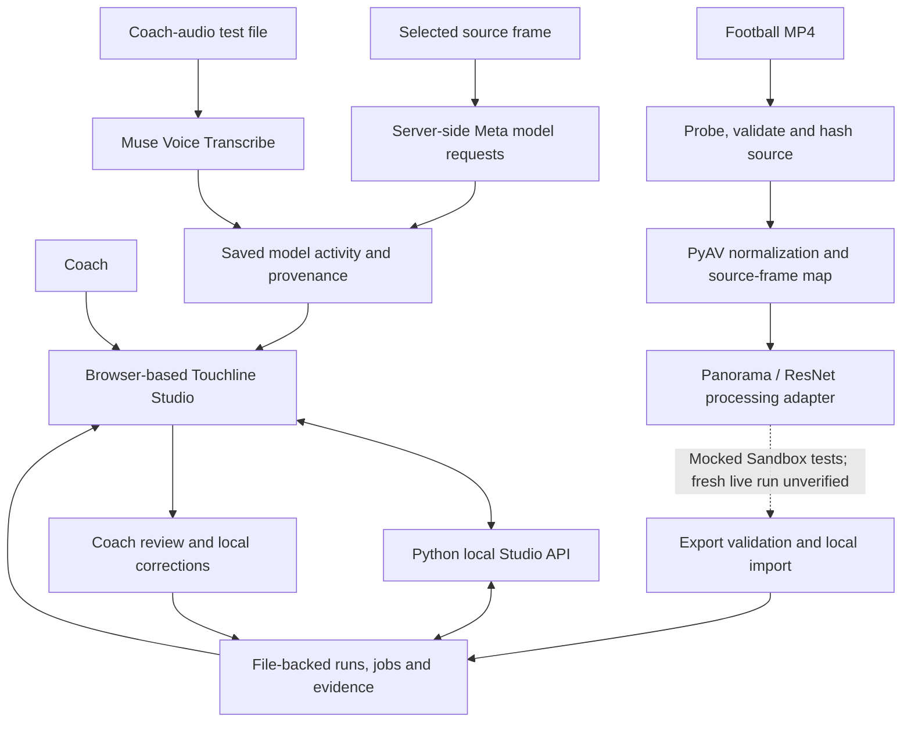

Copyright (c) 2026 Team Vikzar. All rights reserved. This repository is made public solely for hackathon submission and judging purposes. No permission is granted to copy, modify, distribute, or use this software for any other purpose, commercial or non-commercial.

# Touchline
### AI-powered football video intelligence and player development

**Turning football footage into meaningful coaching insights and continuous player development.**

Touchline is an AI-powered football development platform that connects coaches, players, schools and parents through video intelligence and continuous player development.

We help coaches analyse training footage, identify important moments, attach observations and feedback to individual players, and follow their development across sessions. Players build a record of their progress, while parents gain visibility into their child's development through updates approved by their coach.

Our goal is to make structured, evidence-based football development more accessible, especially for grassroots players and school football programmes.

---

## Explore the hackathon prototype

The hackathon deliverable is **Touchline Studio**, the coach-facing prototype that demonstrates selected parts of the larger Touchline workflow.

A useful way to explore the current build:

1. **Open the Coach Studio:** browse saved local analysis runs and inspect the available football video, timeline observations and evidence.
2. **Explore Meta model activity:** submit a selected football frame to SAM 3.1, Muse Spark or Muse Wonder, or submit an audio test file to Muse Voice Transcribe. Review the saved response and its input provenance.
3. **Inspect coach review:** examine model proposals, review decisions and temporary track corrections. These are local review records, not verified player identities or a production roster.
4. **Understand the processing boundary:** inspect how a fresh MP4 is prepared and validated, and how the Panorama/ResNet processing adapter is structured. The fresh live Modal GPU path is not yet verified end to end.

For a guided walkthrough and presenter script, see [Product Demo and Meta Model Usage](docs/PRODUCT_DEMO_AND_META_MODELS.md). This is a demo guide, not a hosted demo-video link.

---

## The problem we're solving

Recording a training session is relatively easy. Turning hours of footage into useful feedback for individual players is not.

Coaches often rely on memory, informal observations and manual video review to understand how players are developing. Finding specific moments, documenting feedback, and checking whether a player has applied a correction in a later session can become difficult to manage consistently.

At the same time, parents often have limited visibility into what their children are working on, how they are progressing, and what their coaches want them to improve.

This creates a gap between what happens on the pitch and the information available to support a player's development.

Touchline aims to bridge that gap.

## Our approach

Touchline connects video evidence, coaching observations and player development into one continuous workflow.

1. **Record:** Coaches upload or access football training footage.
2. **Analyse:** AI assists in identifying players, relevant moments and visual evidence within the footage.
3. **Review:** Coaches inspect important moments, add observations and provide feedback linked to individual players and coaching objectives.
4. **Track:** Coaching objectives and evidence are carried forward into subsequent sessions, allowing coaches to review whether specific corrections are reflected in later footage.
5. **Share:** Coaches can approve understandable progress updates and relevant highlights for parents.

The coach remains central to the process. AI assists with reviewing and organising information; it does not independently decide whether a player has improved or whether a football action was technically correct.

## What Touchline aims to provide

### For coaches

- Review training footage through a video-centred workspace.
- Identify and revisit important moments.
- Associate observations and coaching feedback with individual players.
- Track specific coaching objectives across sessions.
- Compare evidence from comparable training sessions.
- Build more structured player-development records.

### For players

- Build a continuous record of their football development.
- Understand what they are doing well and what needs attention.
- Revisit coach feedback and relevant video evidence.
- Follow progress against individual coaching objectives.

### For schools and academies

- Organise training sessions and player-development information.
- Give coaches a more consistent way to document individual progress.
- Build a connected view of player development across programmes and teams.

### For parents

- Gain visibility into their child's development.
- Receive relevant highlights and coach-approved progress updates.
- Understand what their child has been working on and what to focus on next.

---

## Why Meta's models matter

When we began exploring Touchline, one thing became clear from speaking to coaches: recording training sessions is only useful if you can actually do something meaningful with that footage.

A coach might notice that a player is struggling with their first touch, positioning or movement. Finding those moments in hours of footage, documenting the feedback and checking whether the player improves in a subsequent session takes time.

We want to make that process much easier.

Meta's multimodal AI and visual capabilities are important because they allow us to explore how different forms of information can work together: what the camera captures, what the coach observes and what the coach says.

We've built our prototype around four complementary Meta model capabilities:

| Meta model | Intended role in Touchline |
|---|---|
| **SAM 3.1** | Visual segmentation and proposals from selected football video frames. |
| **Muse Spark** | Multimodal visual observations that can help coaches examine what is happening in a frame. |
| **Muse Wonder** | Contextual reasoning around coaching objectives, evidence and the limitations of what a frame can establish. |
| **Muse Voice Transcribe** | Converting spoken coaching instructions into text that can be reviewed and associated with a session. |

These capabilities are not intended to operate as isolated AI demonstrations. Our aim is to connect them into a useful coaching workflow.

For example, imagine a coach asking a player to improve their first touch. Touchline could help the coach identify relevant moments from that session, attach feedback to those moments, and bring up footage from a later session so the coach can review whether there has been progress.

Instead of feedback getting lost after training, it becomes part of the player's development history.

We do not want AI making coaching decisions. We want it to reduce the manual work around reviewing footage and tracking progress, allowing coaches to spend more time actually developing players.

---

## What we've built for the Meta AI Developer Hackathon

We're building **Touchline Studio**, a working coach-facing prototype that demonstrates the foundations of this larger platform.

The prototype brings together a video-review workspace, football footage, timestamped evidence, local coach annotations and Meta model integrations.

### 1. Video intelligence workspace

Coaches can browse saved analysis runs, inspect available source or annotated video, navigate timestamped observations and review provisional player tracks.

The implementation includes a local Studio server, video-processing interfaces, run management and evidence presentation.

### 2. Meta model integrations

We've implemented a Meta model activity workflow inside the Studio interface.

The current prototype has received genuine responses from all four model integrations:

- **SAM 3.1:** A real response was received from a selected frame of authorised football footage. Bounding-box proposals can be reviewed against the corresponding source frame when its exact image can be verified.
- **Muse Spark:** A genuine multimodal response was received from a real football frame and is available for coach review.
- **Muse Wonder:** A genuine response was received for a coaching objective. In one test, it correctly identified that a wide still image could not establish whether a player had performed a shoulder check or improved.
- **Muse Voice Transcribe:** A genuine transcription response was received using a locally generated spoken-audio test file. This demonstrates the transcription workflow, not yet a validated real-coach recording workflow.

### 3. Coach review and feedback

The prototype allows model-generated proposals and observations to be reviewed locally.

Coaches can record review decisions and make temporary track corrections through a file-backed workflow. These corrections are kept separate from the original evidence.

Player identity is not automatically established by a detection box or temporary track ID. Coach review remains necessary.

### 4. Video processing foundations

The repository includes a Panorama/ResNet processing path, video preparation and normalization, timestamp correspondence, artifact validation and a bounded Modal Sandbox integration.

The fresh-video processing sequence has passed offline tests using a mocked Sandbox and a fresh MP4 fixture. A complete fresh browser-to-live-Modal-to-coach workflow has not yet been verified.

These foundations are intended to support the broader video intelligence workflow as the prototype develops.

---

## Technical implementation

The prototype is more than a set of standalone model calls. Its current engineering work connects a browser-based review interface, a local Python service, media preparation, model activity records and coach review.

| Layer | What is implemented in this repository | Important boundary |
|---|---|---|
| **Frontend** | Browser-based Coach Studio with saved-run browsing, video playback, timeline/evidence presentation, Meta activity and local review controls. | A local coach workspace, not a deployed multi-club web application. |
| **Backend** | Python 3.12 Studio server, local API routes, file-backed run records and job status. | Jobs and records are local; there is no durable distributed queue or production tenant service. |
| **Video pipeline** | MP4 probing and bounded preparation, PyAV-based 24 FPS analysis-copy normalization, source-to-normalized frame correspondence, SHA-256 input/artifact checks and export validation. | Fresh-video preparation and import are tested with fixtures/mocked execution; this does not prove a fresh live GPU run. |
| **Computer vision** | Panorama/ResNet worker contract, adapter and bounded Modal Sandbox dispatch boundary, plus validated export/import into a reopenable local run. | The worker/checkpoint deployment is not included as a verified live service; fresh Studio-to-live-Modal execution remains unverified. |
| **Meta integrations** | Server-side requests for SAM 3.1, Muse Spark, Muse Wonder and Muse Voice Transcribe, with saved activity records, input provenance and coach-review handling. | Genuine smoke-test responses are not a reliability study. Voice transcription was tested with generated speech, not a validated coach recording. |
| **Review and provenance** | Local coach decisions, separate temporary-track correction runs, source/frame hashes and explicit uncertainty boundaries. | Local review records are not tamper-proof, authenticated roster identity or production approval records. |

### How the prototype's technical pieces connect



The diagram deliberately separates the tested local workflow from the unverified live Modal execution boundary. The more detailed component and deployment-target diagram is in [System Architecture](docs/TOUCHLINE_SYSTEM_ARCHITECTURE.md).

---

## Our longer-term technical direction

Touchline is designed around a simple principle: **every meaningful development insight should be connected to the player, the session, the coaching objective and the underlying evidence.**

Our proposed video analytics pipeline includes:

1. Video ingestion and preprocessing.
2. Player detection and tracking.
3. Timestamped observations and movement trails.
4. Spatial analysis and pitch calibration where camera conditions allow.
5. Evidence-linked coaching observations.
6. Session-to-session comparisons.
7. Coach-reviewed development summaries.

Over time, we intend to explore additional capabilities such as:

- Player movement paths and heatmaps.
- Time spent in visible activity intervals.
- Drill participation and session summaries.
- Calibrated distance and speed estimates.
- Sprint and acceleration events.
- Ball tracking and skill-specific analysis.
- Tactical positioning and movement patterns.

These are development targets, not claims that every metric is already available or validated. Real-world measurements such as speed and distance require suitable camera calibration, reliable tracking and comparison against reference data.

We would rather provide a smaller number of trustworthy insights than fill a dashboard with numbers that coaches cannot rely on.

For the implemented processing boundary and current evidence, see the [System Architecture](docs/TOUCHLINE_SYSTEM_ARCHITECTURE.md) and [Scalability Strategy](docs/TOUCHLINE_SCALABILITY.md).

---

## From a working prototype to a connected platform

The current Studio is a local, file-backed implementation. It demonstrates important pieces of the workflow, but it is not yet the complete multi-club platform we envision.

Our next development priorities are:

| Stage | Focus |
|---|---|
| **1. Strengthen video intelligence** | Improve player detection, tracking, video evidence and processing reliability on real football footage. |
| **2. Connect coaching objectives** | Make it easier to associate coach instructions, observations and relevant footage with individual players. |
| **3. Demonstrate longitudinal development** | Connect comparable footage across sessions and allow coaches to review evidence of progress. |
| **4. Build player-development records** | Organise observations, coaching objectives and validated metrics into continuous player histories. |
| **5. Extend to schools and parents** | Develop appropriate school, coach, player and parent experiences with consent and access controls. |
| **6. Scale the infrastructure** | Move from local file-backed processing towards durable storage, managed background jobs and secure multi-club deployment. |

The architecture and scalability strategy describe how we intend to move from the current prototype towards this broader platform. Proposed production infrastructure should not be confused with infrastructure already deployed.

---

## Privacy and responsible development

Football footage can contain identifiable information, particularly when working with school-age players.

Privacy, consent and access control are therefore important parts of Touchline's intended product architecture.

Our direction includes:

- Appropriate consent from schools, guardians and participants.
- Controlled access to identifiable footage and player records.
- Clear video retention and deletion policies.
- Coach approval before progress reports or highlights are shared with parents.
- Careful handling of player identity and uncertain AI observations.
- Avoiding unsupported performance claims or misleading comparisons.

AI-generated observations should remain distinguishable from coach-confirmed feedback and validated measurements.

---

## Repository and technical documentation

This repository contains the current Touchline Studio implementation, source code, tests and supporting technical documentation.

| Document | Description |
|---|---|
| [System Architecture](docs/TOUCHLINE_SYSTEM_ARCHITECTURE.md) | Current implementation and proposed system architecture. |
| [Scalability Strategy](docs/TOUCHLINE_SCALABILITY.md) | Proposed path towards scalable processing and deployment. |
| [Review Gates](docs/REVIEW_GATES.md) | Review and validation boundaries. |
| [Panorama Integration](docs/TOUCHLINE_PANORAMA_INTEGRATION.md) | Panorama integration proposal and implementation boundaries. |

---

## Running Touchline Studio locally

**Requirements:** Python 3.12 or newer.

From the repository root:

```bash
python3.12 -m venv .venv
source .venv/bin/activate
python -m pip install -e '.[vision]'
python -m touchline studio --runs-dir ./runs --port 8765
```

Open:

```text
http://127.0.0.1:8765/
```

The local Studio workspace can be opened without a Modal account. Real Panorama processing remains subject to the required checkpoint, approved code bundle, compatible runtime, access controls and spending approval.

The default server is intended for local development, not public hosting.

### Offline tests

```bash
PYTHONPATH=src:tests python -B -m unittest test_meta_activity test_meta_studio_api -q
node --test src/touchline/web/*.test.cjs
node --check src/touchline/web/app.js
```

The focused checks above cover the Meta activity/API path and browser-side tests; they are not a claim that the entire repository test suite passes. The latest focused verification recorded for this prototype was **24 Python tests and 46 JavaScript tests passing**. Fresh MP4 preparation/normalization and Panorama orchestration were also exercised with generated fixtures and a mocked Sandbox. A fresh live Studio-to-Modal GPU run has not been verified. The repository currently has no GitHub Actions workflow, so these results should be read as local test evidence rather than a hosted CI badge or continuous-integration result.

For the implementation-specific test boundaries and remaining validation work, see [System Architecture](docs/TOUCHLINE_SYSTEM_ARCHITECTURE.md) and [Testing Notes](docs/TESTING.md).

---

## Current implementation boundaries

We believe it is important to be clear about what the prototype demonstrates and what remains future work.

| Area | Current status |
|---|---|
| Coach-facing Studio workspace | Implemented locally. |
| Saved run browsing and video evidence | Implemented locally, subject to available verified artifacts. |
| Meta SAM 3.1, Muse Spark, Muse Wonder and Muse Voice Transcribe | Genuine local smoke-test responses recorded. |
| Local coach review and temporary track corrections | Implemented locally. |
| Fresh MP4 processing sequence | Offline mocked-Sandbox tests passed. |
| Fresh live Modal GPU execution | Not yet verified end to end. |
| Persistent player identity and roster management | Not yet implemented as a production service. |
| Validated real-world speed and distance | Future work requiring calibration and reference validation. |
| Durable cloud storage and multi-tenant deployment | Future production work. |
| Parent-facing reports and connected player-development histories | Part of the product vision; not yet a deployed platform. |

A detection or temporary track ID does not establish a player's identity. Pixel movement does not establish real-world distance or speed. Model-generated observations do not independently establish technical correctness or player improvement.

We intend to validate these capabilities against real footage and appropriate reference data before presenting them as reliable measurements.

---

## Our vision

We believe every young footballer should have access to structured, individual development support, not just those playing in professional academies.

A coach should be able to understand what a player worked on, revisit the moments that matter, document feedback and see whether that feedback carries into future sessions.

A player should be able to understand their own development. A parent should be able to see meaningful progress. A school or academy should be able to support that process consistently.

**Touchline aims to connect all of them through video intelligence and continuous player development.**

We're starting with a working prototype. The larger ambition is a connected player-development ecosystem for football.

---

**Built by Vikzar for the Meta Global AI Developer Hackathon.**

