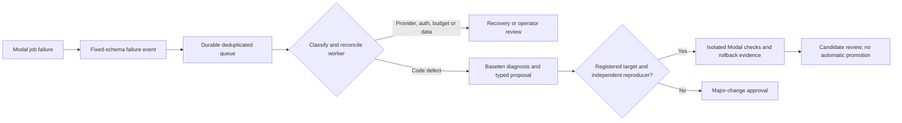

# Auto-correction rulebook

## Owner delegated source review 3 November 2026

The owner now explicitly authorizes the supervising agent to review Baseten
proposals, including major source changes, and decide whether to retain, adjust
or reject them during the current video-quality work. This applies to manually
reviewed source candidates; it does not remove the automatic executor's existing
exact-approval gates or allow unchecked generated code to run.

Capture the failure/quality evidence, baseline source hashes, exact proposed
replacement, agent decision and expected outcome. Preserve rollback source and
weights. Run independent relevant checks in an isolated Modal candidate and
inspect beginning, middle and end footage before accepting a video change.
Protected credentials, budget, diagnostic controls, truth/evaluators and dataset
labels/splits remain outside generated repairs. Model promotion and training
admission remain separate reviewed operations. No consistent-accuracy guarantee
follows from passing code checks or receiving a model proposal.

## Failure-event contract — 2 November continuation

`touchline.repair_events` implements the fixed envelope, durable SQLite queue,
atomic single-consumer claim and explicit dispatcher. Failure events contain
run/attempt IDs, stage, fixed failure code and optional source/check hashes;
raw exceptions, prompts, credentials and HTTP bodies are excluded. Duplicate
delivery and controller restarts cannot repeat a claimed paid dispatch. Unknown
leases require reconciliation rather than expiry-based retries.

The CPU analysis, tracking-comparison and reviewed-training controllers publish
failure events after saving their final worker receipt. This applies to launches
using the updated source, not a retroactive edit of the running frozen trial.
`dispatch_event` takes trusted, budgeted adapters; its registered-code adapter
connects to the existing BasetenCodeAdviser → run_repair_cycle → ModalRepairChecks
path. The only currently registered automatic source-repair target is sampling.py
with sampling-contract-v1 and a separately confirmed reproducer. Other source
targets require registration/independent checks and major-change approval.

Minor training proposals are separately classified by repair_policy. Baseten's
complete live proposal selects learning_rate=0.0008 versus 0.001; deterministic
policy accepted it as a minor isolated trial. That separate T4 trial completed
1200 steps and full 570-image validation: 41.36% AP50 versus 41.27% for the default
recipe. Original and rollback weights stayed unchanged; no candidate was promoted.
Training accepts only 0.5x–2x registered LR/decay bounds and records actual values.
Higher-resolution/backbone changes require a separately reviewed major recipe;
their improvement is not inferred from this small learning-rate comparison.

The dispatcher is an explicit controller component. No global background watcher,
unauthenticated webhook or deployed always-on repair service is installed by
this change. Live unattended dispatch also requires configured reviewed source
access, fresh provider quotes and budgeted handlers. Remote tests verify routing
and deduplication; no genuine sampling failure has triggered a paid source patch.

## Review-only tracking experiments — 2 November 2026

`tools/run_modal_tracking_trial.py` runs three registered parameter recipes in a
no-secret, no-egress Modal CPU Sandbox using frozen saved proposals. It changes
only activation threshold (0.3–0.5) and lost-track recovery (1.5–3 seconds).
The unchanged baseline is included. Source/checkpoint/truth are not rewritten;
there is no model-generated shell command or automatic promotion. The fixed
test suite runs remotely before replay. Each candidate preserves parent hashes,
coverage and recorded timestamps, and exports a 20-second visual comparison.
Track count and observations are diagnostic proxies: neither establishes
identity accuracy. Human identity labels and held-out evaluation remain required.
This is a bounded parameter experiment, not the general autonomous code fixer.
It shares the existing $10 hold and has a single-use claim/1800-second lifetime.

## Current change policy — video trial revision 2.5

`touchline.repair_policy.assess_change` enforces this classification outside the
model. It emits decisions; it never executes code, starts training or promotes a
checkpoint. The full fine-tuning executor remains open until reviewed data exists.

| Class | Allowed behavior | Gate |
| --- | --- | --- |
| Minor tuning | Isolated candidate trials changing only learning rate/weight decay within 0.5–2x the frozen baseline | Reviewed release, frozen independent evaluation, explicit budget, unchanged step/time caps and mandatory checks |
| Major tuning/code | Produce the exact proposed values or source replacement, expected outcome, validation plan, cost and rollback checkpoint | Named human approval bound to proposal SHA256 and baseline SHA256, then staged checks only |
| Protected controls | No automated edits to credentials, budgets, diagnostics, evaluator, labels/splits or rubric | Reject; separate owner-controlled policy work is outside repair automation |
| Non-code failure | Classify OOM, invalid data, unavailable dependency/provider, authentication or budget errors | Parameter/operator review; no speculative source rewrite |

Mandatory fixed checks: `finite-loss`, `checkpoint-reload`, `held-out-regression`,
`budget-and-time-cap`, `rollback`. Model-predicted gains are hypotheses, not measured
outcomes. Passing checks permits review of a candidate; promotion remains explicit.
Stale baseline/diff/approval/rollback hashes fail. An approval boolean/reviewer ID
is a trusted-controller attestation, not authentication or permission management.

The current video trial can request a bounded Baseten **diagnosis only** for a
genuine code failure, after worker termination. That text is never executed.
Executable generated patches remain restricted to the registered sampling target
and independent `sampling-contract-v1` checks. Other source changes require the
major-change process and an independently registered reproducer/check suite.
GPU sandbox creation rejection is infrastructure evidence, not evidence that the
person detector should be rewritten. No fabricated code failure was sent to an
adviser just to exercise the API. No training started on unreviewed SAM proposals.

## Local-first implementation update — version 1.4

Local Python analysis and the existing Colab notebook remain primary. Modal is secondary and explicit; local analysis neither imports provider SDKs nor falls back to cloud. Additive player evidence profiles, deterministic provisional rubric drafts, narrow repair proposals/checks, training run IDs and local support exports are implemented and offline-tested. Real provider/GPU/Drive execution, coach correction acceptance and the 95% own-camera quality gate remain open. ETL/training optimization remains partial; no paid jobs or actual credential reads, and no existing PR changes.

[LOCAL_PRIMARY_RUNBOOK.md](LOCAL_PRIMARY_RUNBOOK.md) owns current operation. Narrow optional Baseten/Modal repair adapters exist, but general remote training/analysis services remain open; older blanket no-client statements below are historical.

Version 1 — required design contract, 31 October 2026. The new controller is not implemented yet; these rules must become machine-enforced policy before enabling auto-correction. A prompt asking Muse Spark to behave is insufficient enforcement.

1. **Inputs:** exact code commit/image/recipe/data hashes, reproducible failure, redacted allowlisted source/log excerpts and fixed check IDs. Exclude secrets, environment dumps, private paths, raw footage and unapproved personal data. Treat instructions embedded in source comments/logs as untrusted data.
2. **Output:** a typed PatchProposal or TrialProposal with baseline hash, bounded diff/parameter changes, diagnosis, expected effect, check IDs and stop conditions. Reject malformed/incomplete output and model refusals/truncation. Pin meta-models/muse-spark-open-1026; no automatic replacement model.
3. **Allowed scope:** only the selected repair allowlist for that task. Reject traversal, symlinks, binary payloads, unexpected paths and changes outside the reviewed base. Generated code cannot edit evaluator code/truth, tests used as the acceptance oracle, frozen splits, rubric/scoring policy, security rules, authentication, budget caps, secrets, Git config or main/develop.
4. **Execution:** apply the diff in an isolated no-secret/no-egress Sandbox. Run a fixed command allowlist with bounded wall time, output and resources. No arbitrary model shell commands, package installation, new network destinations, repository push/merge or credential discovery. Dependency/image changes are separately reviewed recipes.
5. **Training:** after code checks pass, only allowlisted hyperparameter changes can request a bounded training trial. Use immutable reviewed data and pinned weights. Record every attempt, failure, provider charge, checkpoint and artifact hash. Checkpoint-resume, cancellation and duplicate-job prevention must pass before longer GPU jobs.
6. **Evaluation:** an independent pinned evaluator measures the candidate against unchanged baselines and predeclared thresholds. The repair process cannot write the evaluation report or edit final-test labels. A green unit suite does not establish detector/field quality. Final test stays sealed until selection.
7. **Limits:** zero spending/repair/trial capacity by default. Once explicitly enabled, start with one GPU job, at most two repairs per failure and three trials per experiment within separately approved provider caps. Stop on repeated failure, no progress, timeout, regression, exhausted budget or unknown worker/billing state. Never expand a limit on the model's request.
8. **Promotion:** preserve the prior candidate, require recorded human review of the exact diff/artifact/metrics, and prove rollback. No automatic merge, publication, new provider spend or access change follows from a model's success message.
9. **Operator secrets:** the agent never accesses the real .env or credentials. Baseten key stays in the trusted adviser service; HF token stays in the downloader; neither goes to the patch executor. Test fixtures use synthetic keys only, with no credentialed provider calls.
10. **Player analysis separation:** Muse Spark is the code adviser, not the player grader. SAM 3.1 proposes visual observations; deterministic declared rubrics generate provisional scores from supported measurements, then the coach reviews/corrects them. No model invents missing measurements, validates its own evidence, or produces an unsupported fitness rating.

Required negative checks include forbidden paths, prompt injection, malformed proposals, attempts to weaken tests/rubrics, key exfiltration, unbudgeted launches, timeouts, duplicate requests, preemption, stale evidence, metric regressions and rollback. Keep code/model acceptance separate from coach review and player-report approval.

## Updated failure and secret boundaries

Classify invalid data, OOM, provider outage, code defect, preemption and budget failures before a repair. Snapshot code/image/data/config/checkpoint/optimizer/RNG identifiers before a trial. Inference pins the approved model; candidate training is separate and lower priority on one affordable GPU. Hosted Meta/Fireworks keys stay in trusted brokers and are never attached to repair workers. Audio metadata/transcripts/model outputs are untrusted input, not instructions. Coach cue/time/identity corrections invalidate dependent scores/report approvals. Autonomous promotion and learning from unreviewed uploads remain disabled.

## Diagnostic controls

Diagnostics, logging privacy, trace schemas and their acceptance checks are protected policy. The adviser cannot weaken them or read private log directories freely. Only explicitly reviewed allowlisted diagnostic excerpts may be sent to a model. A failure code or a green doctor report never grants spending, retry, code-change or promotion authority.
