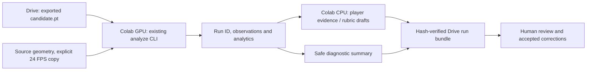

# Video and player analysis entirely in Colab

## Current workflow - 2 November 2026

Use notebook revision 2.3 with EXECUTION_MODE='cpu_analysis' for new CPU detector
inference, or cpu_replay for saved proposals. GPU compute is reserved for reviewed
model training. CPU inference requires compatible weights and Torch/Torchvision;
replay still skips model/CUDA admission. Start with 120 selected samples at 6 Hz,
then explicitly set MAX_SELECTED=None for a fresh full-video run. Source remains
constant 24 FPS. Earlier CUDA-only/default statements below are historical.
Read [CPU_ANALYSIS_RUNBOOK.md](CPU_ANALYSIS_RUNBOOK.md) for local full-video logs
and complete overlays. No provider key is required for either CPU mode.

## Controlling media revision — 1.7

Operator revision 1.7 supersedes exact 1920x1080 admission: accept consistent unrotated landscape dimensions, including 4096x1080 panoramas; analysis remains exact constant 24/1 FPS. Explicit CPU normalization creates a video-only analysis copy without resizing or changing playback speed, with source/output hashes and an exact zero-based source-frame/PTS correspondence. Original footage and audio remain untouched. CLI/notebook and offline conversion checks are implemented; actual long-video Colab conversion, GPU inference and player/tracking quality acceptance remain open. Free compute only; no browser integration, credential access, paid services or existing PR changes.

See [24 FPS conversion instructions](COLAB_ANALYSIS_RUNBOOK.md#panoramic-video-conversion).

Colab is the primary runtime for training **and this analysis workflow**. Your computer only opens the notebook and reviews/downloads outputs; a local Python installation and Modal account are not required. Keep the current training notebook for ETL/training and use the new analysis notebook to reuse existing weights without retraining.

## Run in seven steps

1. Open [02_video_analysis.ipynb in Colab](https://colab.research.google.com/github/buildtouchline/touchline/blob/feature/modal-training/notebooks/02_video_analysis.ipynb). If GitHub access is unavailable, download that notebook from the code branch and use Colab File > Upload notebook. Select a GPU runtime.
2. Run setup using a current feature/modal-training code ZIP, or keep the matching checkout already extracted under `/content/touchline-starter`. The bootstrap is shared with the training notebook. Do not upload the large dataset ZIP as code. No `.env` or model API keys are needed.
3. Run the runtime gate. It preserves the working Torch/Torchvision pair, adds the vision extra and checks CUDA NMS. Select a runtime compatible with the trusted checkpoint. A `.pt` extension alone does not prove compatibility.
4. Mount Drive and edit `VIDEO_PATH`, `CHECKPOINT_PATH` and `DRIVE_OUTPUT_ROOT`. The checkpoint is `model-runs/<training-experiment>/candidate-train/candidate.pt`. `release.json` describes the dataset and cannot replace the weights. The full image dataset is unnecessary for video inference. Optional `EXPORT_DIR` enables the existing export hash/lineage inspector.
5. Set `RUN_ANALYSIS=True`, keep `MAX_SELECTED=120`, and run the capped smoke test. Consistent unrotated landscape dimensions are accepted at constant 24/1 FPS; run step 3b to convert other cadences first. The full source is CPU-preflighted even for a capped run. After checking the smoke run, set `MAX_SELECTED=None` and rerun into a new generated directory for full analysis. It uses the existing detector/tracker, not new training or a cloud provider.
6. Run the player-profile cell. Initially leave calibration/rubric/context unset: observed tracks are reported, identities stay unresolved and unsupported physical measurements remain null. Supply genuinely reviewed identity/calibration/context/rubric only when available. Coach corrections/final approval remain separate acceptance work.
7. Run support export and Drive-save cells, including after failures that wrote a manifest. A unique bundle goes to `Touchline/analysis-runs/<run-id>-<timestamp>/`. Verify `TRANSFER_COMPLETE.json` exists before disconnecting or deleting working files. It contains the original run ID and verified artifact hashes. Incomplete transfers retain the local source and have no completion marker.



## Outputs and reuse

The generated bundle contains available `run/manifest.json`, observations, coverage, analytics, review HTML and associations, plus profile drafts, support snapshots and runtime versions. It copies only known generated artifacts, not the source video, weights, checkout or credentials. These product files may contain player/session information; keep the bundle private and share the support snapshot separately when debugging.

Analysis uses its existing manifest run ID and checkpoint hash/provenance. New training has separate child run IDs and its Colab experiment parent ID. The runtime's run directories live under `/content/touchline-analysis`; durable exports live on Drive. This is explicit export, not automatic live synchronization or remote monitoring. If failure occurs before a manifest exists, preserve the CLI trace and use `diagnostic-report` before resetting the runtime.

`SAMPLER_MODE='anchors24'` uses zero-based frame indices 5/17, the 6th/18th frames. `fixed` uses the existing six-samples-per-second default. This notebook does not implement adaptive sliding-window bursts or prove sprint coverage. The 95% precision/recall quality gate is still unpassed. A partial smoke run is never full-session evidence.

For repeated large-video reads, copy the selected source to `/content` and point `VIDEO_PATH` there, preserving the original and verifying the copy before analysis. Google recommends reducing mounted-Drive small I/O; GPU availability, runtime lifetime and Drive quota are variable. Save outputs before disconnecting. [Official Colab FAQ](https://research.google.com/colaboratory/faq.html).

## Boundaries

The analysis notebook invokes the same existing Python modules; it adds no second detector implementation, public web server, tunnel or Modal dependency. Local CLI use remains available. Optional Baseten repair candidates stay staged and human-reviewed; generated code is not executed inside the Drive-authorized notebook. Hosted SAM, autonomous repair and bulk Modal GPU training remain separately gated work.

The notebook is shipped unexecuted. Offline tests exercise disabled defaults, explicit weight/cap/sampler selection, selected-file export and failed-transfer behavior using fixtures. Actual Colab GPU/checkpoint/Drive execution and player accuracy still require your runtime trial. See [training runbook](COLAB_RUNBOOK.md), [primary flow](LOCAL_PRIMARY_RUNBOOK.md) and [ticket reference](TICKET_REFERENCE.md).

## Uploaded-model selection update — 31 October 2026

The generated input cell now comes from notebooks/analysis_inputs.py and discovers candidate.pt files only under MyDrive/Touchline. Multiple candidates require an exact CHECKPOINT_OVERRIDE; last.pt is listed separately. For the operator's uploaded bundle, use CHECKPOINT_OVERRIDE = TOUCHLINE_ROOT/'touchline-model-last-pt'/'candidate.pt'. Generic repository defaults remain unset. Adjacent result.json hashes are checked before loading; architecture/runtime metadata is still validated by the detector loader. No arbitrary model is chosen on failure.

The starting sampling comparison is now fixed six detector samples/second; anchors24 remains available. Source acceptance remains 1080p constant 24 FPS. The run verifies its manifest detector hash and exports raw_proposals.jsonl with the private product artifacts. More samples may help association, but no measured accuracy improvement is established. These checks have 301 passing guarded offline tests.

Free Colab only; no paid compute units or provider jobs. The operator granted Drive access, but file work is restricted to Touchline and browser work to the explicitly authorized notebook. Actual .env/credentials and Secrets remain prohibited. The uploaded candidate's hash/recipe/result were inspected; actual model inference and IDF1 evaluation are pending. The browser integration was stopped on operator request.

The proposed IDF1 target is 0.85, stretch 0.90, on held-out SoccerNet reference IDs, with detection precision/recall and ID switches also reported. Current normal analysis still uses the greedy IoU baseline, and the dedicated original-FPS image-sequence benchmark/ByteTrack comparison is not implemented here. This does not close the 95% own-camera detection gate or establish roster identity.

If Colab cannot load output JavaScript, check sign-in and the Google-documented googleusercontent.com cookie exception. The operator changes browser privacy settings; do not disable protections globally or bypass browser warnings. See the [Colab FAQ](https://research.google.com/colaboratory/faq.html).

## Panoramic video conversion

Update to the latest feature/modal-training code before using this function, then restart/re-run setup if the old modules are already imported. Select the original video in the input cell. Run step 3b with RUN_NORMALIZE=True, then run the existing analysis cell against its resulting VIDEO_PATH. A source such as 4096x1080 at 25 FPS becomes 4096x1080 at 24 FPS. No source deletion or metadata-only FPS change occurs.

Equivalent Colab cell after code setup:

```python
from pathlib import Path
import datetime
from touchline.video.normalize import normalize_video

ORIGINAL_VIDEO = Path('/content/drive/MyDrive/Touchline/118577.mp4')
NORMALIZATION_DIR = Path('/content/touchline-normalized') / datetime.datetime.now(datetime.timezone.utc).strftime('%Y%m%dT%H%M%S%fZ')
VIDEO_PATH = normalize_video(ORIGINAL_VIDEO, NORMALIZATION_DIR)
print('Verified 24 FPS analysis input:', VIDEO_PATH)
```

The output is video-only H.264 CRF18. Keep the original audio/source. Mapping selects the latest source frame at or before each output time, so dropping/repeating does not change playback speed; output endpoint rounding is under one frame. Original PTS/time base and zero-based source indices are in frame-map.jsonl, with hashes/recipe in normalization.json. Use them to align MOT annotations and reviewed audio offsets. The notebook exports those two provenance files with its analysis bundle when NORMALIZATION_DIR matches VIDEO_PATH; it does not export the converted video. If reusing a converted copy in another session, restore NORMALIZATION_DIR to its directory as well.

Check /content disk capacity before a large conversion. H.264 output may be larger than the input and encoding/validation scans the full video; MAX_SELECTED=120 only limits later inference. Interrupted copies lack normalization.json: keep them for inspection and retry into a fresh directory. No long-video throughput or actual GPU accuracy has been verified. Increasing the detector's default maximum side beyond 1920 or tiling requires a separate memory/recall benchmark; simply accepting panorama geometry does not improve accuracy by itself.

## Visual review and CUDA verification — revision 1.8

Use notebook step 4b after a successful/partial saved analysis. It produces `WORK/preview-<time>/overlay24.mp4`, contact-sheet.jpg and preview.json, displays the video/contact sheet and exports them when step 7 runs. It does not run inference again. Green = saved track, amber = other recorded proposal; brief HELD overlays are labelled and are not new observations. Set VISUAL_HOLD_SECONDS=0 for exact sampled-frame overlays. Temporary track IDs are not roster names. Preview ends at processed coverage; inspect the actual overlay before treating metrics as useful.

Equivalent manual code after setup, with existing WORK/RUN_DIR/VIDEO_PATH:

```python
from touchline.video.preview import render_run_preview
from IPython.display import display, Video, Image
PREVIEW_DIR = WORK / ('preview-' + datetime.datetime.now(datetime.timezone.utc).strftime('%H%M%S%f'))
render_run_preview(RUN_DIR, PREVIEW_DIR, source=VIDEO_PATH, max_seconds=20)
display(Image(filename=str(PREVIEW_DIR/'contact-sheet.jpg')))
display(Video(str(PREVIEW_DIR/'overlay24.mp4'), embed=True, width=1100))
```

Keep the existing Colab session while inspecting saved results; do not delete its runtime just to render. An exported JSON bundle does not include source footage. The standalone touchline_preview.py helper delivered with the handover works with the current saved-run schema and avoids restarting the session: upload that helper and use runpy.run_path to obtain render_run_preview. It calls only existing video/data modules, not providers or model loading. Existing renders can be downloaded or saved to a fresh private Touchline folder; older notebook export cells do not include preview files, so rerun the updated exporter or copy the preview directory explicitly.

For future inference use the updated feature/modal-training code and DEVICE='cuda'. No need to rerun FPS conversion when a verified copy exists. New manifests include detector_runtime: actual model_parameter_device, last_input_device, inference_calls, gpu_name and gpu_peak_allocated_bytes. The notebook asserts CUDA for inference and exposes min/max resize controls. CPU staging at torch.load is followed by model.to(cuda); conversion/preflight/overlay encoding still use CPU. Do not infer subprocess GPU usage from a notebook process's memory counter after the subprocess exits. Older manifests only record requested detector.device and cannot reconstruct actual memory telemetry retroactively. Peak allocated bytes follow [PyTorch CUDA memory reporting](https://docs.pytorch.org/docs/stable/notes/cuda.html); they are not utilization percentage or accuracy.

Verify on a new capped 120-frame run before a full run. The shipped tests use CPU media and fake GPU telemetry only: actual Colab/GPU execution and all quality targets remain pending. Free compute only, no .env/Secrets access or browser integration. Keep provenance and originals.

## Clear player mapping — revision 1.9

Readability revision 1.9 adds resolution-scaled black-backed T-ID badges, deterministic colors and leader lines, a first-observed player-crop gallery and track index, and an optional 960x540 24 FPS focused-track video. Proposal clutter is hidden by default. Focused view never switches identity to fill missing observations; held overlays remain explicit. 316 guarded offline tests pass, with a synthetic panorama readability check. This changes display only; jersey recognition, roster identity, actual Colab/footage acceptance and tracking quality remain unverified. No new inference, GPU/provider job, credential access or existing PR change.

`T7` means temporary track 7, not jersey number 7. A colored badge and leader line link that ID to the player's box. Colors repeat, so the printed ID is authoritative. Labels scale with source width to remain readable when the panorama is shown at 1100 pixels. Collision-avoidance tries neighboring badge positions; very dense crowds may still overlap, so inspect the gallery/focused view.

Additional outputs: `players.jpg` (first-observed crops for at most 64 IDs), `track-index.json` (all IDs with first/last frame and observation count in this preview interval), and optional `focus24.mp4` (960x540). The gallery is a visual lookup, not an identity classifier. Re-appearing under a new ID stays a separate entry. Frame numbers/times are relative to the analyzed normalized source, not a new jersey/roster mapping.

Start with `FOCUS_TRACK_ID=None`, inspect the gallery/index, then select an observed integer such as 7. Use `focus_track_id=FOCUS_TRACK_ID` in render_run_preview or CLI `--focus-track-id 7`. A missing ID is rejected before rendering; a gap in that track becomes a NOT OBSERVED frame. Do not use nearest-player substitution or bridge identity gaps. `SHOW_PROPOSALS=False` keeps amber diagnostics hidden; use `--show-proposals` for audits. The notebook displays/exports gallery/index/focused video with the existing artifacts. All rendering is CPU-only reuse of saved inference; detector CUDA behavior is unchanged.

For an existing Colab session, download the updated standalone touchline_preview_clear.py, upload it with files.upload(), and obtain render_run_preview with runpy.run_path. No runtime restart or detector rerun is needed while WORK/RUN_DIR/VIDEO_PATH and the source remain available. Render into a fresh preview directory. Save the new artifacts explicitly or use the updated Drive exporter; an older exporter may omit the new gallery/focused files. The optional focused crop includes black padding near source boundaries and rescales only its review copy; the full overlay and original source geometry remain unchanged.

## Stationary-panorama revision 2.0

Stationary-panorama revision 2.0 adds optional pinned ByteTrack motion/low-score association, saved-proposal replay into a new run, and explicitly reviewed sampled-frame IDF1 evaluation. New Colab trial uses 12 detector samples/s on a 24 FPS source, 240 selected frames, CUDA detector inference and gated CUDA batched Kalman prediction; matching, correction and lifecycle remain CPU-side. No silent CUDA fallback. 333 guarded offline tests pass, including the real CPU ByteTrack backend and synthetic CUDA guards. Actual CUDA math/parity, runtime speed and real-video 75% minimum/80% desired IDF1 remain unverified. No paid/model/GPU execution, credential access, browser use or existing PR changes by the agent.

Follow [the ByteTrack/CUDA runbook](BYTETRACK_RUNBOOK.md). This supersedes earlier six-FPS/IoU trial defaults; old results remain available for comparison.

## GPU-quota exhaustion: notebook revision 2.1

Notebook revision 2.1 adds an explicit cpu_replay default for exhausted GPU quota, skips Torch/CUDA and checkpoint admission in that mode, restores saved-run artifacts, retains explicit cuda_analysis for later GPU use, adds reviewed IDF1 evaluation/export and optional hash-verified source-video preservation. A visible notebook version and required-code check reject stale feature checkouts. TPU remains unsupported. 336 guarded offline tests pass; actual Colab/Drive/CUDA and real-footage quality remain unverified. CPU replay changes association only and cannot recover players absent from cached proposals. No real credentials, browser integration, paid/GPU/model job or existing PR changes.

Download/open the new notebooks/02_video_analysis.ipynb; pushing a repository notebook does not update a separate Drive notebook. Load its matching code ZIP. The notebook checks required tracking files early; an old /content/touchline-starter checkout is not upgraded merely by opening a new notebook. Use a fresh code directory and restart the kernel when replacing imported code; preserve run files and source footage first. Do not delete the runtime as an upgrade step.

For today choose a standard CPU runtime, EXECUTION_MODE='cpu_replay'. Run setup/runtime and Drive/input cells. In step3a set SAVED_RUN_DIR to the run subfolder containing manifest.json, coverage.jsonl and raw_proposals.jsonl. Set VIDEO_OVERRIDE to the exact analyzed normalized 24 FPS source if its path changed. Skip the new detector-analysis cell. Enable RUN_RETRACK=True; RETRACK_DEVICE is explicitly cpu in this mode. Then run visualization/profiles, optional genuinely reviewed IDF1 scoring, and Drive export. No checkpoint/Torch/CUDA requirement for CPU replay. If raw proposals were lost, cached reassociation is unavailable and detection must be rerun separately; an unlabelled saved model alone cannot reconstruct the prior detections.

The run bundle excludes footage. Before changing or losing the runtime, optionally set SAVE_ANALYZED_VIDEO=True in step7b to copy the exact analyzed video under Touchline/analysis-videos, verify its run-source hash, and write VIDEO_COPY_COMPLETE.json last. Check Drive quota yourself and retain the original until verification completes. A later preview requires that identical source; the original 25 FPS input is not interchangeable with its converted 24 FPS copy. Replay itself can proceed without footage, but video overlays cannot. [Colab FAQ](https://research.google.com/colaboratory/faq.html) explains that runtime files are temporary and resource limits vary; no fixed GPU-reset time is promised.

When free GPU access returns, select EXECUTION_MODE='cuda_analysis', run the CUDA/NMS/parity checks, select weights/video, and use the existing bounded GPU trial. There is no automatic hardware fallback or TPU implementation. CPU mode imports no Torch/CUDA runtime; no paid provider path is enabled. New IDF1 evaluation runs only when TRACKING_REFERENCE_PATH is explicitly supplied and genuinely reviewed. Scores cover the admitted sampled frames; no accuracy is inferred from missing labels.

## Final notebook/backup revision 2.2 — 1 November 2026

Revision 2.2: notebook now embeds one final complete backup for current/parent-run artifacts, exact analyzed video, previews, player gallery, JSON/JSONL, profiles, evaluated scores and selected result dictionaries, with SHA256 checks and a completion receipt. Added explicit restore/replay run order, video-hash admission and recreated-video hash verification. 339 guarded offline tests pass. Operator reports initial capped inference and exact-hash video recovery; real ByteTrack acceptance, CUDA prediction parity, complete Drive backup/restore acceptance and 75–80% IDF1 remain unverified. ETL/training remain partial and new fine-tuning is deferred, not completed. No full ticket is closed solely from fixtures or scaffolding.

Follow [the current operational handover](CURRENT_HANDOVER.md). Step7c is the single complete backup; restore from current/run and the saved video, whose paths the cell prints. Separate exports7/7b are optional. In CPU mode the run order is3a restore →4R replay →4b preview →optional evaluation/profiles →7c backup. Restore and replay are distinct cells.
