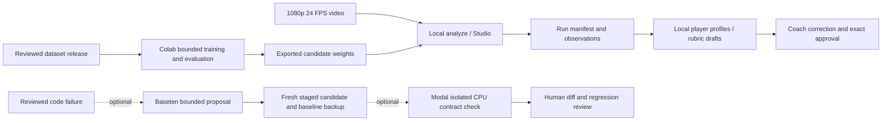

# Local and Colab first; optional cloud checks

## Controlling media revision — 1.7

Operator revision 1.7 supersedes exact 1920x1080 admission: accept consistent unrotated landscape dimensions, including 4096x1080 panoramas; analysis remains exact constant 24/1 FPS. Explicit CPU normalization creates a video-only analysis copy without resizing or changing playback speed, with source/output hashes and an exact zero-based source-frame/PTS correspondence. Original footage and audio remain untouched. CLI/notebook and offline conversion checks are implemented; actual long-video Colab conversion, GPU inference and player/tracking quality acceptance remain open. Free compute only; no browser integration, credential access, paid services or existing PR changes.

See [24 FPS conversion instructions](COLAB_ANALYSIS_RUNBOOK.md#panoramic-video-conversion).

## Run analysis in Colab — version 1.5

Use [COLAB_ANALYSIS_RUNBOOK.md](COLAB_ANALYSIS_RUNBOOK.md) and notebooks/02_video_analysis.ipynb to run the existing video/profile pipeline in Colab with exported weights. No local Python installation or Modal is required. The training notebook remains unchanged. Drive export verifies generated-file hashes; actual runtime/quality acceptance remains open. 297 guarded offline tests pass.

31 October 2026. This is the controlling execution-path revision. Local Python analysis and the existing Colab training notebook remain primary. Modal is optional and explicitly selected. Missing credentials, unavailable cloud services or rejected repairs never trigger a cloud fallback or replace the current detector.

## Existing path

1. In Colab, audit labels, build the immutable dataset release, train a bounded Torchvision candidate, compare held-out results, reload it and export artifacts. ETL/training optimization remains incomplete; successful execution alone does not accept a model.
2. Keep `dataset-releases/<experiment-id>/release.json` beside its images. This is the dataset; `model-runs/<experiment-id>/candidate-train/candidate.pt` contains the weights. The manifest copy in the model export does not include images.
3. Locally install the existing video/training extras as needed, inspect the export and select the compatible checkpoint using the CLI or explicit owner-only settings. Local inference needs no Modal, Baseten, Meta or Fireworks key.
4. Analyze a landscape 1920x1080 constant 24/1 FPS video using the existing `analyze` command or local Studio. Preserve its generated run directory. Sampling can reduce detector calls; it does not change source FPS or establish accuracy.
5. Review track identities and calibration before accepting player-specific physical estimates. Unresolved identities and unsupported measurements stay unknown.

See [Colab](COLAB_RUNBOOK.md), [export reuse](USING_COLAB_EXPORT.md) and [analysis setup](ANALYSIS_FIRST_RUNBOOK.md). Existing entry points and local dependency defaults remain in place.



## Additive local player analysis

From the selected checkout, after the normal analysis run:

```text
python -m touchline player-analysis runs/session-001 --output runs/session-001-profiles
```

Use a new output directory on every invocation. Input is the run's `manifest.json`, `observations.jsonl` and optional reviewed `associations.json`. Output is `player-analysis.json` plus a short `review.md`. No provider calls, credential loading or retraining occur.

Every observed track is retained. Profiles include frame indices, original PTS/time bases, observed support, source/model/sampler lineage and unknown reasons. Support on selected frames is not continuous player visibility. Distance and speed estimates require locally reviewed identity, valid calibration and usable motion segments; maximum speed is windowed, not an instantaneous sprint guarantee. Passes/shots/tackles/fitness remain unsupported.

Optional inputs are `--calibration reviewed-calibration.json`, `--session-context reviewed-session-context.json` and `--rubric reviewed-rubric.json`. The calibration uses the existing `Calibration` contract. Rubrics use `touchline.rubric.v1`: a versioned ID, drill/context, reviewed attestation, explicit supported metrics/units, lower/upper bounds, direction, weights summing to one, minimum observation/support limits and coach-provided drill/success/review templates. Missing dimensions produce a null total; weights are never silently renormalized. Draft rubric points are not independently validated ability ratings. Synthetic fixtures cannot be scored as player evidence. Coach correction persistence, approval UI and genuine field acceptance remain open tickets.

## Run IDs and local support exports

New training runs write `run-record.json` before training and retain the ID in candidate metadata and results. Optional `--run-id` and `--parent-run-id` correlate a run and its experiment; fresh output directories prevent overwrites. The Colab notebook supplies its outer experiment ID as the parent and labels both training steps `colab`. Existing video analysis keeps its manifest run ID. Optional repair checks get `repair-<attempt-id>` and record the worker identifier when known.

`--execution-backend` is a provenance label only: specifying `modal` does **not** submit training to Modal. Bulk Modal training, periodic checkpoint/resume and remote log streaming are not implemented or verified. Legacy training exports without a run record retain their original evidence; the exporter refuses to invent an ID.

```text
python -m touchline run-log-export runs/session-001 --output runs/support-session-001 --diagnostics-dir runs/diagnostics
```

This creates `support.json` and numeric-only `losses.jsonl`. The optional trace summary uses the recorded trace ID and the explicitly selected diagnostics directory. Export excludes raw exceptions, source footage, credentials, player records and arbitrary files. It is a local snapshot, not a live log stream. Keep the full private run directory for investigation; export a new snapshot after a failure. The agent can inspect only files actually made available in this workspace; remote jobs are not automatically monitored.

## Optional repair automation

Offline preparation/staging are callable independently:

```text
python -m touchline repair-prepare . --output runs/repair-case-001.json
python -m touchline repair-stage runs/repair-case-001.json runs/proposal-001.json --source-root . --output runs/repair-001
```

The current registered target is only `src/touchline/video/sampling.py`, with immutable check bundle `sampling-contract-v1`. Preparation reads that source file only; staging validates a bounded replacement, checks the baseline hash, preserves `baseline.py` and writes `candidate.py` in a fresh directory. It never executes or overwrites live source. More targets require separate reviewed policies and checks.

The library's `run_repair_cycle` composes an injected `BasetenCodeAdviser` and `ModalRepairChecks`; there is deliberately no auto-enabled CLI watcher. An operator must independently approve the source sent to the adviser, verify account/model access and current rates, initialize cumulative spending records, supply existing app/image references, and explicitly enable both stages. Optional provider dependencies are in the `providers` extra; local inference does not need them. SDK loading is lazy. Actual `.env` access by the coding agent remains prohibited.

Baseten is pinned to `meta-models/muse-spark-open-1026` at `https://inference.baseten.co/v1`; compatibility/access is unverified. The client uses explicit credentials, timeout and zero SDK retries. The bounded JSON proposal cannot add commands or alter guards, tests, budgets, datasets or evaluator policy. At most two attempts per immutable case are tracked in durable SQLite; duplicate or uncertain attempts cannot be blindly replayed.

The optional Modal checker uses an existing approved CPU image/app, gVisor, no network, no secrets, no volumes, bounded CPU/RAM/time and mandatory termination. Trusted local code compares structured results against its own expected answers. AST restrictions are only a filter; sandbox isolation, independent checks and human promotion remain necessary. Passing this narrow sampler contract is not full application, security or model acceptance.

Reservations precede paid dispatch and remain held until final billing. Unknown worker termination blocks further Modal dispatch. OOM, invalid labels, authentication failures and budget failures require parameter/data/operator review rather than automatic source edits. A checked candidate still requires human diff review, full regression checks and rollback evidence before manual promotion. The live detector and analysis continue unchanged.

## Google Drive and optional Modal storage

Drive can remain the team's reviewed artifact exchange: Colab mounts it explicitly, and a locally synced Drive Desktop directory can receive exports. A Drive sharing URL is not a local filesystem path or Modal mount. No Drive OAuth connector, automatic sync or remote storage deployment is added here.

For future optional Modal training, stage a versioned release into a Modal Volume, verify hashes before compute, write unique run directories there, commit the completed artifacts, then explicitly export to Drive/local storage. Keep active controller SQLite on one durable local controller, not on a shared multi-writer Volume. Budget storage/transfer as well as compute.

Drive can reject requests for permissions, quota, storage or rate limits. Use authenticated least-scope access, bounded backoff for retryable 403/429 errors, resumable transfers and final hash verification; do not retry permission failures blindly. Preserve the previous good artifact until a transfer verifies. `drive.mount` in Colab does not carry authentication into Modal. No guarantee of uninterrupted Drive access is possible.

Sources: [Modal Volumes](https://modal.com/docs/guide/volumes), [Sandbox networking](https://modal.com/docs/guide/sandbox-networking), [Sandbox resources](https://modal.com/docs/guide/sandbox-resources), [Drive limits](https://developers.google.com/workspace/drive/api/guides/limits), [Baseten Model APIs](https://docs.baseten.co/inference/model-apis/overview), [Python SDK configuration](https://developers.openai.com/api/reference/python).

## Verification and remaining gates

293 guarded offline tests pass, including the complete mocked proposal-stage-check cycle, stale receipt rejection and local player-analysis CLI. Syntax checks cover 89 Python files and 13 unexecuted notebook code cells; local documentation links resolve. Tests use synthetic observations and mocked provider clients. No actual credential reads, paid calls, Modal deployment, Drive transfer or new training job is included. The proposed 95% precision **and** recall at IoU >= 0.5 remains an unpassed independent own-camera gate. End-to-end cloud training, actual SAM visual validation, coach-reviewed scoring acceptance and measured quality improvements remain open. See [ticket reference](TICKET_REFERENCE.md) for canonical status.
