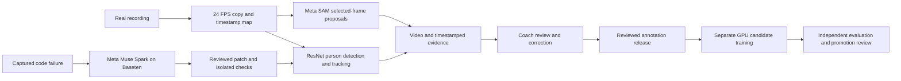

# Touchline Meta model usage and product demo script

Delivery update 4 November 2026: a verified180-second,1080p24FPS real-recording
sample is available in [Video Results](RCNN_VIDEO_REVIEW.md).
It uses preserved GPU ResNet observations and includes experimental track IDs;
it does not establish identity accuracy or full-recording/coach-loop acceptance.
The unused L4 allocation was cancelled. The larger full-recording scope below
remains unfinished; the delivered sample is a separate completed demo artifact.

Updated 3 November 2026
Prepared for project handover
Product: Touchline by Team Vikzar

Touchline helps coaches turn a recorded football session into visual evidence they can review and correct. The demo should follow one real recording from input to player observations and a coach decision. Show uncertainty openly and use only artifacts that have actually been generated.

## How the models work together

| Component | Role | What it does not establish |
| --- | --- | --- |
| Torchvision Faster R-CNN ResNet50 FPN v2 | Owner-selected person detector for the next video analysis | It is not a Meta model. Its current official COCO weights are not our fine-tuned football checkpoint |
| Meta SAM 3.1 | Selected-frame visual analysis, person proposals and disagreement review alongside the detector | SAM boxes are model proposals, not ground truth, confirmed identities or automatically accepted training labels |
| Meta Muse Spark Open 1026 hosted by Baseten | Code diagnosis and bounded repair proposals under the rulebook | Hosting is Baseten; the selected model identifier is `meta-models/muse-spark-open-1026`. It does not independently approve changes or guarantee accuracy |
| Modal | Isolated execution, GPU inference/training, source checks and artifact export | Modal provides compute; changing GPUs does not by itself improve model accuracy |
| Coach | Confirms identities, reviews uncertain observations and records corrections | A temporary track number does not become a confirmed player without review |

### Visual analysis with SAM 3.1

We preserve the original video and create a timestamp-linked 24 FPS analysis copy. R-CNN detects people on selected frames, and tracking associates detections over time. Selected exact frames are sent through a trusted backend broker to Meta SAM 3.1 using `https://api.meta.ai/v1/responses`.

We retain the image hash, frame index, geometry, request receipt and returned proposals. SAM and R-CNN disagreements identify moments to inspect, such as missed people or false boxes around equipment. In the current experimental association, SAM-supported moments also constrain when new session IDs can be created. This is a proposal-assisted tracking rule, not proof of identity.

Verified in the current work: six PXL frame requests and eight SoccerTrack review requests completed successfully. The proposal files remain unreviewed for training. No automatic training from the uploaded PXL analysis video has occurred.

### Code improvement with the Meta model hosted on Baseten

The trusted controller calls the OpenAI-compatible Baseten API at `https://inference.baseten.co/v1`, selecting `meta-models/muse-spark-open-1026`. The OpenAI library is the client interface; it does not mean an OpenAI model is being used for these requests.

The repair sequence is:

1. Capture a failure event or a concrete quality issue with its source/run lineage.
2. Send bounded, relevant code and sanitized evidence to Baseten. Exclude credentials, raw provider errors and unrelated project data.
3. Validate the returned proposal. Truncated or invalid proposals are rejected without execution.
4. Review exact changes. The owner has delegated major source review to the supervising agent for this task; protected controls remain outside generated repairs.
5. Apply an accepted or adjusted candidate separately, run checks in Modal, inspect real video evidence and retain rollback source.

Actual example: Baseten identified risks in propagated motion boxes and identity matching. Its proposed border clamping was not accepted unchanged: pinning an off-screen box to the image edge could create a ghost player. The agent adjusted the fix to reject invalid motion vectors explicitly and preserve uncertainty. Relevant remote checks passed. This is evidence of a reviewed repair, not an unrestricted always-on self-healing service.

### Reviewed learning loop

The reviewed learning loop is the intended product architecture. Uploaded videos and coach comments do not silently become training truth, and serving weights are not replaced automatically.

## Product demo script

Target length: approximately 2 minutes 45 seconds. Use one real recording throughout. The following is a recording script, not a statement that all integration steps are already complete.

| Time | Show | Narration |
| --- | --- | --- |
| 0:00–0:15 | A short section of the actual football recording | “Coaches already record training. The difficult part is finding the moments that matter and connecting them to the right player. Touchline turns that footage into a reviewable session.” |
| 0:15–0:35 | The recording input and the selected run ID; show an actual upload UI only if connected | “We start with one real recording. Touchline prepares a 24-frame-per-second analysis copy and keeps a map back to the original timestamps, so every observation can be traced to the footage.” |
| 0:35–1:05 | A completed annotated video, readable track labels and the player gallery | “ResNet detects people, and our tracking layer links observations across the session. These labels are temporary track IDs, not jersey numbers. The gallery helps the coach locate the person they want to review.” |
| 1:05–1:30 | An actual selected-frame comparison with SAM proposals | “Meta SAM provides an additional visual check on selected moments. Where models disagree, we preserve the evidence for review rather than treating another model's answer as ground truth.” |
| 1:30–1:55 | Pause on a genuine identity mistake or uncertain track; record a real coach correction | “The coach remains part of the loop. They can confirm the player behind a track, reject an observation, and attach a correction to that point in the recording. We preserve the original evidence and who reviewed it.” |
| 1:55–2:20 | Sanitized Baseten proposal, review decision and actual test receipt | “We also use Meta Muse Spark through Baseten to investigate code failures. Proposals follow a rulebook. Changes are reviewed, checked in an isolated Modal environment, and kept reversible.” |
| 2:20–2:45 | Return to the recording, corrected evidence and exported session files | “The result is a session the coach can inspect and correct, with video, timestamps and clear evidence. Reviewed labels can later improve a separate model candidate, which must pass independent evaluation before it replaces the current version.” |

### Short model explanation for the presenter

“Meta supports two parts of Touchline. SAM 3.1 helps us inspect people in selected video frames and find disagreements worth reviewing. Meta Muse Spark Open 1026, hosted on Baseten, helps us diagnose code issues and propose fixes under a rulebook. Our ResNet detector performs the main person detection, Modal runs the compute, and the coach makes the final identity and evidence corrections.”

### Thirty second pitch

“Touchline helps football coaches review recorded sessions with player detections, movement evidence and timestamps. Meta SAM adds a selected-frame visual review, while Meta Muse Spark through Baseten supports reviewed code repairs. Coaches can inspect uncertain moments and correct identities before evidence feeds a future training release. We keep the original footage, model lineage and corrections so the analysis remains reviewable.”

## What can be shown honestly now

- Real PXL and SoccerTrack frames, model comparisons, SAM request receipts and proposal artifacts exist.
- The owner selected ResNet after viewing paired real-frame results. Beginning, middle and end still-frame comparisons exist.
- Reviewed source repairs and remote test receipts exist; the latest verified suite reached 456 checks before the failed full-video replacement.
- A completed full ResNet annotated recording has **not yet been exported**. The preferred full-video attempts encountered worker/controller failures; a higher-GPU recovery is being prepared.
- Persistent frontend job submission, shared result storage and a full coach-correction acceptance run are not established by the operator scripts alone.

Use a real completed short clip if available when recording the demo. If the preferred full recording is still processing, label the shown clip with its actual duration and run ID. Do not substitute a synthetic walk-through or present an unfinished run as complete.

## Claims to keep out of the demo

- Do not claim 80–95% tracking accuracy without a labelled tracking evaluation.
- Do not present a box confidence score as overall accuracy.
- The 84.85% SoccerNet AP50 result belongs to the separate fine-tuned MobileNet candidate and its fixed validation set; it is not a ResNet or PXL tracking result.
- Do not show physical distance, speed, a pitch minimap or performance scores as validated without the required calibration, identity and review evidence.
- Do not describe automatic retraining, automatic model promotion or unrestricted code repair as delivered.
- Voice capture/transcription and improvement plans are follow-up features unless their real inputs and end-to-end outputs have been verified.

Fireworks AI is an optional backend model service. Frontend web hosting on Fireworks has not been established; the demo should name the actual UI host if deployed. See [Fireworks documentation](https://docs.fireworks.ai/getting-started/introduction).
