# Touchline recording to coach integration agreement

Delivery update 4 November 2026: [the three-minute real-recording demo](RCNN_VIDEO_REVIEW.md)
has been exported and verified. It is a bounded sample from preserved ResNet
results, not an accepted full-recording service or completed coach-correction
integration. The discrepancies and remaining integration boundaries below still
apply.

Updated 3 November 2026
Prepared for project handover

Yes: the **Modal Sandbox worker is the selected full-recording execution approach**. It is currently an operator workflow, not a deployed frontend video function. The preferred ResNet full recording has not completed a verified local export yet. A short successful trial does not establish full-recording integration or a complete coach demo.

## Resolve the conflicting claims

| Claim | Verified position |
| --- | --- |
| `track_video_gpu.remote()` is the selected entry point | No such symbol was found in the inspected `src`, `tools` or `docs`. Do not integrate against it without an exact revision and runtime receipt |
| `feature/modal-provider-pipeline` at `dc24134860ecec614ff5460311670d8cdbb103f6` contains the latest full worker | It is the last verified published baseline. Latest full-recording and ResNet work is unpublished in the working checkout |
| MOT, annotated video and minimap are one verified output contract | Annotated video and JSON evidence are implemented paths. A MOT text export and calibrated pitch minimap are not verified outputs of this selected worker |
| The ResNet path is already an accepted full-video service | It is the owner-selected analysis candidate. Full export and coach-loop acceptance remain open after the worker/controller failures |

Implementation branch: [feature/modal-provider-pipeline](https://github.com/buildtouchline/touchline/tree/feature/modal-provider-pipeline). Planning source: [tickets](https://github.com/buildtouchline/touchline/tree/tickets). No new PR for the unpublished worker changes has been verified.

## Selected execution path

```mermaid
flowchart LR
    V[Real coach recording] --> B[Authenticated backend dispatcher]
    B --> S[Bounded Modal Sandbox]
    S --> N[Validate and normalize to 24 FPS]
    N --> D[Owner selected ResNet analysis]
    D --> E[Timestamped evidence and annotated video]
    E --> R[Coach review]
    R --> C[Versioned identity or evidence correction]
    C --> O[Recomputed review output]
```



The backend should wrap the controller as an asynchronous job. A persistent Modal Function is optional. The frontend should send an authorized upload reference to the backend, not call a temporary Sandbox filesystem or an assumed `.remote()` function.

## Input contract today

### Legacy full recording worker

Files staged under `/work`:

| File | Meaning |
| --- | --- |
| `recording.mp4` | Original uploaded recording |
| `candidate.pt` | Selected fine-tuned MobileNet checkpoint |
| `code.zip` and `worker.py` | Frozen source and worker |
| `job.json` | SHA256 values for those inputs |

The worker verifies inputs and creates `/work/normalized/video24.mp4`, `frame-map.jsonl` and `normalization.json`.

### Preferred experimental ResNet worker

It reuses an immutable prepared filesystem image containing the normalized video and official R-CNN weights. Its current AMP entry point reads `/work/rcnn-gpu-amp-job.json`, `/work/rcnn-gpu-amp-code.zip` and the staged worker script.

Internal job example, with placeholder values:

```json
{
  "code_sha256": "SHA256_OF_FROZEN_SOURCE",
  "weights_sha256": "dd69338a24b8d7381807e247652bdc356325bcbaf1cd3e092e00e0a1a58706bf",
  "video_sha256": "SHA256_OF_NORMALIZED_VIDEO",
  "source_sha256": "SHA256_OF_ORIGINAL_RECORDING",
  "cpu_parent_worker": "PREPARATION_WORKER_ID",
  "mode": "full",
  "detector_fps": 6,
  "session_id_cap": 24,
  "decoder_threads": 4,
  "fp32_reference_zip_sha256": "SHA256_OF_PRECISION_REFERENCE_ARCHIVE"
}
```

These fields are trusted-controller configuration, not the public upload API. The backend resolves approved paths and hashes. The prepared worker does not accept arbitrary browser-provided model paths, scripts or fetch URLs.

The ResNet weights are official Torchvision COCO weights, separate from the trained MobileNet `candidate.pt`. The worker checks the exact architecture and weight hash. SAM proposals are optional analysis evidence, not accepted training labels.

## Current limits

| Boundary | Current implementation |
| --- | --- |
| Legacy recording admission | Original file at most 5 GiB; duration 2–900 seconds; unrotated landscape; largest dimension at most 8192 pixels |
| Analysis copy | Constant 24/1 FPS, source geometry preserved, video-only copy |
| Preferred detector sampling | 6 Hz in the native ResNet trial; a separate reduced-resolution adaptive experiment is not the selected integration baseline |
| Current GPU pilot scope | Hard-coded check for the selected PXL normalized recording with 17,830 frames, approximately 12 minutes 23 seconds |
| Session identity capacity | At most 24 allocated session IDs; unresolved extras remain unassigned |
| Latest approved T4 replacement | Up to 90 minutes, sharing the original $3 trial cap; this attempt failed and its termination was confirmed |
| Higher GPU | Owner permits an upgrade if needed; exact next resources and runtime require the budgeted launcher and a new receipt |

The hard-coded PXL frame count must be replaced by a reviewed source-metadata limit before general frontend uploads are supported. Do not advertise a general 15-minute GPU API based solely on the legacy admission check.

## Output contracts and paths

### Legacy canonical run artifacts

The established schema uses:

```text
run/manifest.json
run/observations.jsonl
run/coverage.jsonl
run/raw_proposals.jsonl
normalized/video24.mp4
normalized/frame-map.jsonl
normalized/normalization.json
preview/overlay24.mp4
preview/players.jpg
preview/track-index.json
profiles/
diagnostics/
recording-receipt.json
recording-results.zip
```

Canonical observations use `touchline.observation.v1`, nested `frame` metadata, `local_track_id`, source-pixel `bbox_xyxy`, confidence, association state and nullable `player_id`.

### Experimental ResNet artifacts

The latest ResNet worker currently writes a separate review bundle:

```text
/work/rcnn-gpu-amp/summary.json
/work/rcnn-gpu-amp/raw_proposals.jsonl
/work/rcnn-gpu-amp/observations.jsonl
/work/rcnn-gpu-amp/coverage.jsonl
/work/rcnn-gpu-amp/pixel-trajectories.csv
/work/rcnn-gpu-amp/overlay24.mp4
/work/rcnn-gpu-amp/players.jpg
/work/rcnn-gpu-amp/contact-sheet.jpg
/work/rcnn-gpu-amp/precision-parity.json
/work/rcnn-gpu-amp/checks.json
/work/rcnn-gpu-amp/diagnostics/
/work/rcnn-gpu-amp/RESULTS.html
/work/rcnn-gpu-amp/results.zip
```

**These raw experimental observations are not yet the canonical nested-frame schema.** They use top-level `frame_index`, `timestamp_s`, `track_id`, `bbox_xyxy`, `footpoint_xy`, `evidence`, flow/camera flags and `identity_confirmed: false`. The backend needs a verified adapter or a canonical writer before it feeds them to existing coach-review commands.

Abbreviated experimental row, illustrating structure rather than a measured result:

```json
{
  "run_id": "RUN_ID",
  "frame_index": 240,
  "timestamp_s": 10.0,
  "track_id": 8,
  "bbox_xyxy": [1200.0, 650.0, 1300.0, 950.0],
  "footpoint_xy": [1250.0, 950.0],
  "evidence": "detector_anchor",
  "foreground_flow_valid": true,
  "identity_confirmed": false,
  "physical_distance_m": null
}
```

Boxes and pixel movement retain the normalized source geometry, currently 3840×2160. The native trial's review video is rendered at 1920×1080. The 24 FPS visualization includes tagged held/estimated boxes between detector anchors; it is not 24 detector inferences per second.

No MOT text file, jersey recognition, calibrated minimap or validated speed/distance output should be added to the integration contract by assumption.

## Timestamp mapping to the original recording

Each normalization-map row contains:

```json
{
  "output_frame_index": 240,
  "output_pts": 240,
  "output_time_base": [1, 24],
  "source_frame_index": 250,
  "source_pts": 128000,
  "source_time_base": [1, 12800],
  "source_relative_time": [10, 1]
}
```

The example values above are placeholders for field shape; load the actual mapping row for the recording. Do not infer the original frame index from nominal FPS.

For analysis frame `i`, the analysis-relative time is `i / 24`. The map identifies the original source frame selected for that output instant. Its absolute media PTS is `source_pts × source_time_base[0] / source_time_base[1]`; `source_relative_time` records its offset from the original media origin as an exact rational.

Normalization uses the most recent source frame at each output instant without speeding up the session. Some original frames may be skipped or repeated. Preserve the original video hash, normalized video hash and complete map. Device creation dates are not a substitute for this media-time mapping or for calibrated audio alignment.

## Job lifecycle and failure handling

The integration lifecycle should be:

1. Accept the authenticated recording reference and create a job/attempt ID.
2. Validate file access, media bounds and approved resources.
3. Normalize or verify an existing exact 24 FPS copy.
4. Run selected-model inference and persist progress/evidence.
5. Render and verify the complete artifact set.
6. Save artifacts in durable storage, then publish authorized download links.
7. Present the evidence for coach review and store a versioned correction.

Current scripts provide JSON progress events and operator receipts, not a deployed frontend lifecycle service. The next controller fix must reconcile worker state after a lost log connection instead of treating it as proof that inference stopped. Inference and rendering must not compete without resource checks. Failed attempts remain failed; partial output must be explicitly labelled and preserved.

Sandbox paths are not download URLs. Shared durable storage and authorized retrieval are still integration work. Temporary filesystem snapshots expire; the current prepared image has a one-day TTL and is not permanent product storage.

## Tight real coach demo acceptance

The next demo should prove this single sequence:

1. Use one actual football recording and retain its source hash.
2. Show a completed annotated clip and its exact timestamped observations.
3. Select a real visible track in the gallery; distinguish temporary ID from roster identity.
4. Have the coach confirm or reject that association and record the reviewer/note.
5. Reopen or recompute the evidence view and show the saved correction.
6. Retrieve the session bundle through the backend without depending on a live Sandbox.

The existing canonical CLI includes `associate` with `--track`, `--player`, `--reviewer` and optional `--name`, `--target` and `--notes`. Only use it on compatible canonical run artifacts and with a genuine coach-confirmed player ID. Do not demonstrate an invented identity as a completed coach review. Preserve the original evidence before applying a correction.

Generic command shape, for the operator to fill with real reviewed values:

```text
python -m touchline associate CANONICAL_RUN_DIR --track ACTUAL_TRACK_ID --player CONFIRMED_PLAYER_ID --reviewer COACH_REVIEWER_ID --notes REVIEW_NOTE
python -m touchline player-analysis CANONICAL_RUN_DIR --output FRESH_PROFILE_DIR
```

The cloud ResNet adapter, backend persistence and this real coach acceptance run remain to be verified together. Keep voice uploads, automatic retraining, advanced scoring and minimaps outside this narrow demo until the recording-to-evidence-to-correction path works.

## Files to reconcile before publishing an integration revision

- `tools/run_modal_recording.py` and `tools/modal_recording_worker.py` — legacy full-recording path.
- `tools/run_modal_rcnn_full.py` and `tools/modal_rcnn_gpu_worker.py` — preferred experimental ResNet path.
- `src/touchline/adapters/rcnn_comparison.py` — exact official weights and architecture loading.
- `src/touchline/video/normalize.py` and `decode.py` — frame correspondence and decoder settings.
- `src/touchline/motion_tracking.py` and `pitch_scope.py` — experimental identity and pitch-scope decisions.
- `src/touchline/player_analysis.py` and the `associate` CLI implementation — canonical evidence/review integration.
- The authoritative tickets and the published code pin — update together after checks and real artifact review.
