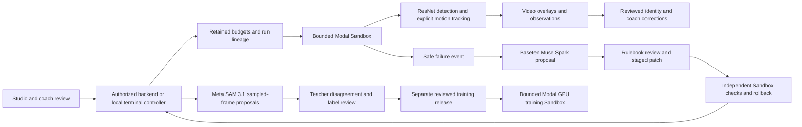

# Selective player-mapping and Modal integration

Updated 4 November 2026. Branch: `feature/player-mapping-modal-integration`.

This branch starts at provider revision
`143b8f9e5a3c2ee330aaa35bc5c7186e298c2f6e`. It selectively adapts components
from player-mapping revision `12668a454d48aaf77b6e05a6dbdb7098855bf1a8`.
Both original branches and their histories remain intact. This is a selected
component integration, not a claim that every change from both branches is merged.

## Primary architecture

The existing source, checkpoints, training/evaluation code, SAM broker, budget
ledgers, diagnostics and Baseten repair controls come from the provider branch.
Modal Sandboxes remain primary. The optional ASGI image client is a separate
integration adapter; it does not replace the full-recording Sandbox workflow.
No endpoint is deployed merely by checking out this branch.

Workers receive approved media/weights/source and no provider keys. Authorized
controllers load the selected private settings at runtime. Never copy a real
`.env`, provider token, dataset, checkpoint or video into Git. No new `.env`
contents are needed for tests. See [the existing settings template](../examples/operator-settings.template).

## Selected upstream components

| Source commit | Component adopted | Integration adjustments |
| --- | --- | --- |
| `13a782b` | JSON calibration and inspect/associate review context | Retains explicit calibration and identity gates; no camera-specific matrix imported |
| `03fdd87` | Coach PTT, appended transcripts and voice-linked reports | Unique IDs across clips, per-clip provenance, atomic serialized append, cue time-window checks |
| `a5aa27f` | Approved player report package export | Fresh output directory, lexical symlink checks, exact approval/version check even for coach exports |
| `25adbca` | Optional Meta speech/tactical adapters and tests | Explicit provider choice; no silent fallback; estimated timestamps labelled; no default paid Studio dispatch |
| `40549f6` | MediaSession headset controls and haptics | Optional browser capability; actual Android/headset acceptance still required |
| `7127d1b` | Protected image detector client and CLI option | HTTPS, no redirects, bounded bodies, model/frame/geometry/score validation and checkpoint pin option |
| `2646c98` | SAM polygon parser and review display | Strict vertex/cardinality/geometry checks; no mask execution or training admission |

The existing 1,200-row Studio truncation is replaced with bounded observation
pages. The browser loads up to 200,000 rows and explicitly labels larger previews
as partial; full artifacts remain available. A session-switch generation guard
prevents late pages from one run replacing a newer selection.

The panorama canvas geometry idea from `e83e7f3` is adapted manually with dynamic
geometry and valid JavaScript. Its entire commit is not imported. Older frontend
hard-coded session defaults are removed; the data source determines geometry.

## Deliberately excluded components

- The alternate `modal_pipeline.py` Function and `fast_tracker` apps. They add a
  second controller/deployment, different dependency versions and a different
  output contract rather than using the selected Sandbox path.
- YOLO implementations and fallback weights. They remain available in the source
  branch; they are not part of this branch's runtime.
- A file-size-based shortcut that copies a saved match's observations and
  associations for an upload, and reports a fixed precision claim. File size is
  not content identity, model provenance or fresh-inference evidence.
- Hard-coded five-column crop coordinates, pitch homography, team colours,
  participant names and preassigned identities for a specific recording.
- Dense all-frame image accumulation and unbounded upload/result blobs for the
  alternate Function. The Sandbox controller must keep bounded streaming/export.
- Documentation declaring production-grade quality, measured tracking precision,
  model deployments or speech-model availability without current run evidence.

Nothing is deleted from either source branch. Selected source revisions are
listed above so omitted components can be reviewed later without losing work.

## Tuning ideas retained as experiments

1. Compare the native-resolution ResNet baseline against configurable overlapping
   tiles. Record tile transforms, merge boxes in source pixels and test seam
   duplicates/misses. No field-specific crop coordinates become defaults.
2. Compare Euclidean footpoint distance as an association feature alongside the
   existing IoU, appearance, foreground motion and ambiguity rules. It must not
   silently override identity uncertainty or the 24-slot session limit.
3. Keep the existing reviewed resize recipe for training comparisons. A trained
   MobileNet AP50 result is separate from official COCO ResNet inference quality.
4. Require surveyed calibration before physical speeds, reviewed clip alignment
   before precise voice attribution, and independent AP50/IDF1 benchmarks before
   claiming an accuracy improvement.

These are bounded follow-up trials, not new automatic training or spending grants.
SAM proposals need human completeness review before training; Baseten cannot
change protected auth, spending, evaluator or truth controls.

## Voice integration boundary

The imported Meta speech/tactical model names are upstream adapter defaults, not
verified available services. Existing successful SAM and Baseten calls are the
verified Meta-model usage. Speech/tactical provider access and schemas need a
separate documented smoke test before launch.

`run_studio_server(..., speech_executor=...)` accepts an operator-supplied
authorized, budget-reserving executor. Without it, HTTP transcription fails
closed and cannot spend simply because a key exists. The executor must reserve
before dispatch, bound the call, persist the safe receipt and never log keys.
Tests call adapters with fake transports only. A headset play/pause event is not
a guaranteed Android hardware recording button.

## Validation and running

Run the combined tests and artifact checks inside a Modal Sandbox using the
existing [local-terminal handover](LOCAL_TERMINAL_HANDOVER.md). The selected
integration is not an additional permission to launch paid jobs. Retain the
source archive digest, test logs and Sandbox receipt.

Use [the recording contract](RECORDING_TO_COACH_INTEGRATION.md) and
[R-CNN review runbook](RCNN_VIDEO_REVIEW.md) for analysis. The current experimental
ResNet output still needs a canonical coach-schema adapter before an end-to-end
Studio claim. Start with explicit reviewed identity, then recompute reports.

Verification: 484 tests passed in the existing approved Modal A10 Sandbox, plus
216 Python source parses, 28 notebook code cells and 137 local documentation
links with no broken links. Source archive SHA256:
`69740188c10c77d5044c84b868c4e98347d2398cc5f88d276ff6f5e94e064f03`.
This snapshot checks the selected integration; later source additions require their own
checks. Ticket checks also passed 49 parents/116 subtasks and 1,589 local links,
with matching CSV/JSON and no dependency cycles. No acceptance ticket is complete merely because components compile.

The new four-minute panoramic review worker/controller is also included as an
isolated operator trial. It preserves native source geometry, uses six-Hz ResNet
anchors and 24-Hz labelled motion predictions, exports bounded evidence and
terminates before independent SAM review. Its live receipt and quality review
remain separate from component regression tests.
