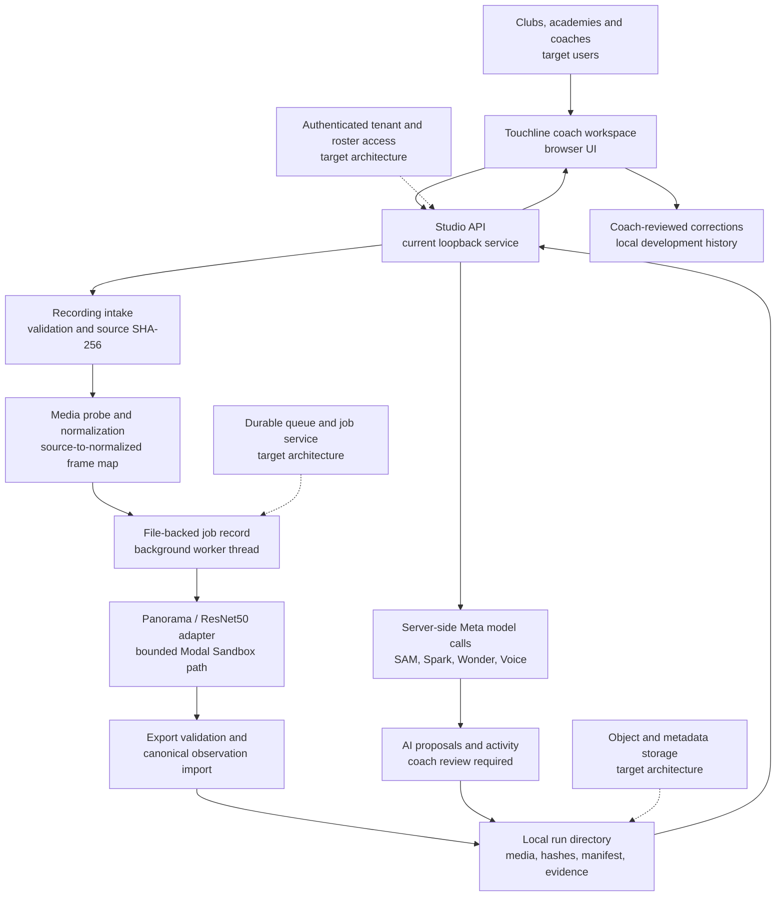

# Touchline Studio system architecture

**Status: 5 November 2026.** This describes executable code in this repository and the separately identified target architecture. It is not a production deployment claim. The [README](../README.md) contains the current setup commands; [scalability strategy](TOUCHLINE_SCALABILITY.md) describes changes needed beyond a local Studio.

## System at a glance

Touchline connects recording evidence to a coach's review. The browser displays source or verified annotated footage, timeline observations, provisional tracks, Meta model activity, and coach decisions. Python Studio handles local API requests, file-backed runs and jobs, preparation, and provider calls. The Panorama/ResNet path has a bounded Modal Sandbox adapter, but a fresh live Sandbox run has **not** been verified. Multi-academy services in the diagram are **targets**, not deployed services.

Solid arrows show implemented local paths or a prepared execution boundary. The Panorama arrow represents **adapter code and mocked tests**, not proof of a deployed worker or successful fresh GPU run. Dashed arrows are proposed production components. The browser never receives provider credentials or Modal worker paths.

## Current capability and evidence

| Capability | Status and evidence |
| --- | --- |
| Coach workspace and local run browsing | **Implemented locally.** Studio lists file-backed runs; the browser can reopen a saved run. No production club directory is present. |
| Video timeline and evidence presentation | **Implemented locally.** Source/annotated media and timestamped observations display when corresponding verified artifacts exist; synthetic QA is explicitly labelled. |
| Video preparation and normalization | **Mock-tested.** Fresh MP4 probing and bounded PyAV normalization are exercised by `test_video_normalize.py` and `test_panorama_backend_orchestration.py`. |
| Frame mapping and provenance | **Mock-tested and importer-tested.** Separate original/normalized hashes and the source correspondence map are validated; historical saved-export import was reviewed. |
| Panorama/ResNet worker | **Source and contract present.** Worker, adapter and checkpoint hash requirement exist; checkpoint bytes and deployed image are absent from this repository. |
| Modal GPU execution | **Integration boundary present; fresh live run unverified.** Sandbox creation/export code exists, but the fresh Studio-to-Modal path has only mocked execution evidence. |
| Meta AI activity | **Four genuine local smoke responses recorded.** SAM 3.1, Muse Spark, Muse Wonder and Muse Voice Transcribe returned usable responses; Voice used generated test speech. Saved outputs and coach review are local, not production reliability evidence. |
| Coach review and temporary-track correction | **Implemented locally.** Model proposals can be reviewed; separate correction child runs are file-backed. A track ID is not a verified roster identity. |
| Production authentication and roster authorization | **Not implemented as a production service.** Loopback development and optional injected bearer/access callbacks are boundaries, not tenant or roster management. |
| Durable cloud storage | **Not implemented.** Jobs, media, activity and revisions are local files; local hashes do not make them tamper-proof. |
| Multi-tenant production deployment | **Not implemented or verified.** No demonstrated tenant isolation, managed queue or horizontally scaled application deployment. |

## 1. Ingestion and media preparation

The coach-facing browser is in [`src/touchline/web/`](../src/touchline/web/). Its [mode-aware API client](../src/touchline/web/api-client.js) keeps explicit synthetic QA, local Studio, and configured production behavior separate; production failure does not silently substitute demo results. Local Studio [`run_studio_server`](../src/touchline/studio.py) serves UI/API routes. The bounded upload route is gated by readiness and creates a new run directory; it retains the original `source_video.mp4` and its SHA-256. This is not a deployed club/session management service.

The [Panorama adapter](../src/touchline/adapters/panorama_worker.py) calls [`probe_video`](../src/touchline/video/decode.py) and [`normalize_video`](../src/touchline/video/normalize.py) before dispatch. The reviewed worker contract requires a stationary 4096 × 1080 panorama, a normalized 24 fps, 5,760-frame, four-minute input, and a frame map. The preparation tests cover source FPS conversion, duration and geometry checks, and separate source/normalized hashes. Camera stationarity needs human review; dimensions alone cannot establish it. The frame map records source-to-normalized correspondence, so original media time is not inferred by dividing an analysis frame index by a nominal FPS.

## 2. Jobs and execution boundary

Studio writes atomic [file-backed job status](../src/touchline/job_state.py) and starts [`PanoramaWorkerAdapter.run_job_async`](../src/touchline/adapters/panorama_worker.py) in a daemon thread after admission. It exposes readiness and job polling routes from `studio.py`. Status and structured stages are available locally; the adapter's intermediate numeric progress values are fixed stage markers, **not measured frame coverage or an ETA**. There is no durable queue, multi-worker scheduler or idempotent submission service. If the process restarts while a job is running, `read_job_status` reports it as **unavailable** pending operator reconciliation rather than claiming success.

Real dispatch is closed by default. Readiness checks include PyAV/libx264, verified checkpoint/code/worker hashes, a Modal SDK and deployment probe, server-side authorization, camera attestation, and a reservable spending ledger. The local loopback server can run without those live prerequisites, but upload remains gated. See [remediation status](PANORAMA_STUDIO_REMEDIATION.md) for the exact live gates.

## 3. Panorama computer vision and export

The selected path is the [Panorama/ResNet adapter](../src/touchline/adapters/panorama_worker.py) and [Sandbox worker](../tools/modal_panorama_worker.py), with its [operator controller](../tools/run_modal_panorama_review.py) as historical execution reference. It does not use the separate RT-DETR/YOLO Fast Tracker route. The adapter verifies actual source, normalized video, checkpoint, code bundle, worker script and frame-map hashes before a live Sandbox is created. It specifies a bounded GPU image/resource configuration, blocked network for the worker and export-before-termination behavior. The pinned checkpoint and image are not bundled or independently deployed-verified here.

The [Panorama importer](../src/touchline/panorama_import.py) validates receipts, summary, frame map, observation rows and artifact hashes before publishing a canonical run. Detector-anchor observations and motion/camera predictions remain separate. Detector scores require an exact normalized-frame and detector-box match; unmatched scores are not guessed. An annotated MP4 is playable only when the verified artifact exists. The historical four-minute export demonstrates import and local review, not accepted identity tracking or a fresh browser-to-GPU workflow.

## 4. Meta activity and coach decisions

[`meta_activity.py`](../src/touchline/meta_activity.py) constructs bounded server-side requests for selected-frame SAM 3.1, Muse Spark and Muse Wonder through `/v1/responses`, and file transcription for Muse Voice Transcribe through `/v1/asr/transcribe`. It validates and stores status, model ID, provider request ID where returned, timestamps, latency, input hash, safe preview or typed failure. New frame requests persist the exact submitted JPEG and verify its SHA-256 on retrieval. Older records without the saved JPEG can show an unavailable preview if exact regeneration fails; saved genuine text remains reviewable. Voice test input was locally generated speech, not a real coach recording.

Model output is a **proposal**. Studio's local review route records coach confirmation/rejection and edited text; Voice text attaches to a session only after approval. SAM boxes and masks do not establish identity. Spark and Wonder text cannot establish an unseen action or two-session progress from one still. Temporary track correction is a separate file-backed child run; its reviewer string and hashes are not independently authenticated coach or roster authority. [Review gates](REVIEW_GATES.md) explain the limits of association and report approvals.

## 5. Evidence, storage and Coach Studio

Local run directories contain source footage, optional normalized/annotated media, frame map, manifest, canonical observations, analytics, job state, activity records and correction lineage when present. The [run records](../src/touchline/run_records.py) and Studio routes permit saved-run discovery and reopening. HTTP range delivery supports video review. Absence or hash mismatch remains an unavailable/failed state; no synthetic evidence is silently substituted in production mode. Local file-backed revisions are logically separate but writable by the same server process; durable immutable storage and authorized downloads are future work.

The [Coach Studio](../src/touchline/web/app.js) joins video, timeline, provisional tracks, evidence, model activity and review controls. It distinguishes source footage from annotated output and exposes technical provenance without turning a model proposal into a coach-approved fact. School-wide roster, parent-facing release and longitudinal player services are product directions, not verified services in this repository.

## Technical integrity and acceptance boundary

- Temporary `local_track_id` values and detection boxes are not confirmed `player_id` values. Historical detection AP50 is not identity F1 or accepted tracking quality.
- Pixel displacement is not calibrated speed or distance. Synthetic examples are not measured athlete improvement. Coach assessments require evidence and interpretation.
- Camera movement, missing calibration, incorrect frame timing, corrupt input, checkpoint mismatch, and partial exports can invalidate a conclusion. Failed or interrupted attempts cannot be promoted to completed runs.
- The current local server, file storage and optional bearer/access hooks are not a production security, availability or tenant-isolation guarantee.

For rollout requirements, see the [scalability strategy](TOUCHLINE_SCALABILITY.md), [Panorama integration review](TOUCHLINE_PANORAMA_INTEGRATION.md) (historical proposal; proposed endpoints are **not** live claims), [remediation](PANORAMA_STUDIO_REMEDIATION.md), [review gates](REVIEW_GATES.md), and [migration provenance](../MIGRATION_PROVENANCE.md).
