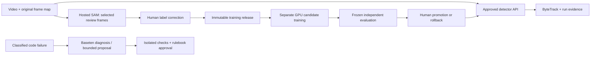

# Video trial, detector service and reviewed training

1 November 2026. Branch: feature/modal-provider-pipeline. Audio is out of the
current trial. Keep the existing Colab/local workflow available; provider paths
are explicit. No existing PR/main/develop merge or change is required.

## Actual run and evidence

Input: `artifacts/videos/118577.mp4`, H.264, 4096x1080, 25 FPS, 240 seconds.
Original SHA256: `f0dfbef3b496867bd2a1261c9a4d4c538d3861bf15b50109e9287c6a1371fc04`.
The original remains untouched. The trial generated the first 20 seconds at
constant 24 FPS, unchanged geometry, with an exact original-frame/PTS map.

Private outputs are under ignored `runs/video-trial-20261101/`:

| Path | Meaning |
| --- | --- |
| normalized/video24.mp4, frame-map.jsonl, normalization.json | Bounded analysis copy and original correspondence |
| sam-review/review.html | Four SAM review overlays/geometry JSON at 0, 5, 10, 15 seconds |
| sam-review/review.json | All four hosted SAM calls returned HTTP 200; 23 proposals/frame; pending human review |
| cpu-reference/manifest.json | Local CPU reference only: complete excerpt, 480 decoded frames, 120 samples, 1130 observations |
| cpu-preview-bounded/overlay24.mp4 | Actual annotated 20-second CPU-reference video |
| cpu-preview-bounded/players.jpg, track-index.json | Temporary-track gallery/index; not jersey/roster identities |
| cpu-profiles/player-analysis.json | 43 unresolved track profiles; physical/coach metrics remain gated |
| modal-job.json and attempt receipts | GPU creation attempts rejected with InvalidError; confirmed no running GPU worker |
| cpu-probe.json | Actual CPU-only Modal sandbox readiness passed and termination confirmed |

SAM returned **proposals**, not 23 verified players. Manual inspection found at
least a candidate false positive on a sideline cart; check missed/overlapping
people and goalkeepers too. No review attestation was forged and no proposed
labels were admitted into training. The 43 CPU track IDs include fragmentation;
they do not establish unique-player count or tracking accuracy. Calibration,
independent reference identities and own-camera quality acceptance remain open.

The panorama preview initially ran out of memory after inference. Preview encoding
now uses two threads and zero lookahead buffering, and avoids unnecessary full
frame copies; the actual full excerpt was then rendered in a fresh process.
Source geometry, timestamps and detection observations were not changed by this
display fix. An earlier partial preview folder is retained as failure evidence.

## What Modal accepts in this setup

### Current: post-payment T4 Function passed

After the user added a payment method and explicitly requested another test,
the single post-payment Function probe in `main` passed `nvidia-smi`:
T4, 15360 MiB memory, driver 610.57.04. The temporary App was explicitly stopped
successfully. Its receipt and UTC stage log are
`gpu-function-main-t4-after-payment.json` and
`gpu-function-main-t4-after-payment.events.jsonl` under the private trial folder.
The earlier failed Function and Sandbox records are preserved unchanged.

This supersedes the earlier GPU-Function-access blocker below. Adding the payment
method was followed by successful access; the credit ledger/actual charges are
still unreconciled. No Sandbox retry, PyTorch/CUDA/Torchvision inference check,
video analysis, training or endpoint deployment was performed in this probe.
The next analysis job must verify CUDA/NMS before detector execution and retain
its own explicit budget, run lineage and cleanup evidence. Labels are still
pending review before training. Four guarded offline Function-probe tests passed,
including reconciliation and duplicate blocking for the one approved retry.

### Latest: separate GPU Function also rejected

The user explicitly requested a separate GPU Function test. On 1 November 2026,
`tools/probe_modal_function.py` attempted one ephemeral T4 Function in `main`,
using the same plain Debian/Python image. No checkout code, models, credentials,
datasets or videos were mounted. The serialized stdlib-only worker was limited
to `nvidia-smi`; zero retries, one container, no warm minimum, 30-second startup
and execution bounds, and a 60-second result wait. These are execution controls,
not a hard total scheduling or provider-dollar limit.

Function setup returned `InvalidError` with GPU/billing-related wording before
the input was submitted. The temporary App was explicitly stopped successfully.
No GPU diagnostic command, detector inference, training or endpoint ran. This
independent execution path also failing makes a Sandbox-specific configuration
cause less likely. The exact billing prerequisite is still unconfirmed; check
the workspace's payment-method/account status and ask Modal to reconcile the
unexplained credit display. The result does not prove $100 was consumed.

- `gpu-function-main-t4.json`: final receipt including App ID/stop confirmation.
- `gpu-function-main-t4.events.jsonl`: run-correlated UTC stage events.
- `tools/probe_modal_function.py`: explicit single-use diagnostic; duplicate
  calls fail before credentials/network. Original Modal hold remains reserved;
  actual charges remain unreconciled. No automatic retry or GPU-type fallback.

Three new guarded offline tests verify Function resource/isolation options,
bounded command metadata and duplicate/approval gates. The prior Function-free
full suite had 373 passing tests, followed by three Sandbox-probe checks; these
new checks do not establish GPU execution or model accuracy. No GPU endpoint is
deployed. Logs suppress raw provider wording, headers and keys.

Latest single diagnostic, 1 November 2026: explicitly selected environment
`main`, used a plain Debian/Python 3.12 image (no training libraries), requested
one T4 with gVisor and a 60-second lifetime. Environment lookup and image
preparation passed. Creation again returned `InvalidError` before a worker ID;
redacted classification now includes **billing-related wording**, with no
concurrency/quota flag. A named lookup confirmed no running worker. This narrows
the investigation but does not establish whether a payment method, account tier,
credit entry or another billing restriction is responsible. No `nvidia-smi`,
GPU inference or training ran. Do not treat absence of a wording flag as proof
that every associated setting is valid.

Private diagnostic evidence under the same trial folder:

- `gpu-probe-main-t4.json`: final receipt, image ID, environment and cleanup state.
- `gpu-probe-main-t4.events.jsonl`: UTC timestamps, elapsed time, run ID and
  individual stages. Convert UTC to IST (+05:30) when comparing dashboard times.
- `tools/probe_modal_gpu.py`: single-use explicit probe; duplicate claims fail
  before credential loading. It preserves the previous Modal $2 hold and does not
  change provider budgets, retry automatically or retain raw error/credential text.

For the app `touchline-video-trial` in environment `main`, check Modal's dashboard
for available creation events and worker logs. No GPU worker was created in this
probe, so it has no GPU process logs. Local events still show the rejected stage.
Training/analysis/repair also have the existing structured trace and run receipts;
these logs are diagnostic evidence, not reconciled provider billing.

Authentication, image build and a CPU gVisor sandbox succeeded. Both T4 and the
separately approved L4 creation requests were rejected before a worker ID was
returned. Metadata lookup confirmed no running worker after those requests.
The exact provider-side GPU restriction remains unresolved; do not describe this
as successful GPU inference or a missing profile ID. The setup uses an explicit
Modal token pair and an absent private-profile path, not the user's CLI profile.

The guide supports GPU Sandboxes with `runtime="gvisor"`; the retry set this
explicitly. There is no automatic GPU upgrade or further retry. CPU repair checks
can use Sandboxes; trusted GPU inference/training can also use regular Modal
Functions, subject to separate runtime/account verification.

### Next GPU diagnostic, before another paid attempt

1. In Modal's dashboard, select the same workspace/environment as the token.
   Check GPU eligibility, workspace resource limits, billing restrictions and
   the rejected Sandbox creation events. CPU success does not prove GPU access.
2. Use the private attempt receipts to correlate the timestamp, requested GPU,
   image ID, SDK 1.6.3 and explicit gVisor runtime with Modal support. Share only
   redacted request metadata. The current safe error category is `InvalidError`;
   it does not identify whether eligibility, capacity or another resource rule
   caused rejection. No exact provider reason was retained in the public report.
3. After the restriction is understood, authorize one new bounded GPU capability
   check. Verify CUDA and Torchvision NMS before video inference. A regular GPU
   Function is an alternative execution path, not evidence GPU access now works.
4. Before training, exercise checkpoint export/resume and termination. Modal
   documents GPU Sandboxes as preemptible; a 600-second lifetime alone is not
   checkpoint recovery. Keep unknown billing reserved until reconciled.

## Cost and privacy boundaries

One additional trial was authorized: Modal $2, Meta $0.75, Baseten $0.25.
`TrialBudget` keeps separate durable holds; duplicate dispatch is rejected and
unknown charges are not released. GPU lifetime was limited to 600 seconds; image
package-install commands have time limits. No GPU allocation occurred. Image-build
and CPU-probe charges remain unreconciled; reserved funds are not measured costs.

The GPU worker receives frozen source, video excerpt and approved weights only,
with no model keys, no mounted credential directory and no outbound network.
Hosted model requests stay in the trusted controller. Error output is fixed
categories/source-line metadata; never raw HTTP headers/bodies, credentials or
traceback locals. Never delete budget/attempt receipts to bypass a hold. The
trial helper is deliberately not a general production job/recovery service.

## Custom detector endpoint alongside SAM

The managed Modal Endpoints product accepts supported serving recipes/compatible
custom weights. This checkpoint is Torchvision Faster R-CNN/MobileNet, not
compatible LLM weights for `modal endpoint create --model Qwen/...`.

Use a custom Modal ASGI web service instead:



Prepared files:

- `src/touchline/detector_api.py`: bounded JSON image requests, exact image hash,
  normalized 24 FPS frame/time coordinates, source-pixel boxes and checkpoint
  provenance. Routes: `GET /healthz`, `POST /v1/detect`. No training route, file
  paths, shell commands or secrets accepted through inference requests.
- `tools/modal_detector_endpoint.py`: explicit deployment factory, mandatory
  `requires_proxy_auth=True`, CPU-only (four cores), one container maximum, scale-to-zero, 120-second
  request bound. Approved code is copied into the serving image, not loaded from
  a mutable code directory. Weights are loaded from a hash-named approved Volume
  path and checked before use. No resource is created by importing this module.
- `src/touchline/repair_policy.py`: deterministic minor/major/protected decisions.
  Read [the rulebook](AUTOFIX_RULEBOOK.md) for approval and rollback requirements.

**Prepared and offline-tested, not deployed.** Deployment requires independently
approved service spending/lifetime, staged approved weights on a named Volume,
verified CPU runtime compatibility and a scoped Modal Proxy Token for HTTP clients.
The earlier GPU trial authorization does not silently enable an ongoing service.
The current factory does not implement a deployment/promotion control plane.

Once the owner has approved deployment and staged the Volume, the trusted
controller can import `build_app` from `tools/modal_detector_endpoint.py`, call
it with the pinned image/checkpoint hashes, then call
`app.deploy(client=approved_modal_client)`. This is a programmatic factory, not a
ready-to-run `modal deploy` module with a global App. Do not call deployment on
import. Verify protected HTTP access and real detections before connecting an
inference client; that client is still pending.

Supported owner-only settings, after deployment:

```dotenv
TOUCHLINE_DETECTOR_ENDPOINT_URL=https://YOUR-APP.modal.run
MODAL_PROXY_TOKEN_ID=
MODAL_PROXY_TOKEN_SECRET=
```

These are separate from `MODAL_TOKEN_ID`/`MODAL_TOKEN_SECRET`, which authenticate
the control-plane runtime. Do not put proxy/model keys in a frontend bundle or
repair Sandbox. The factory remains protected even if no proxy token is configured.

## Review, training and code repair

Review each SAM image/JSON pair and correct every relevant person/negative, not
only boxes the model found. Keep the four frames in the same capture group. They
cannot be split between train/validation to manufacture independent evidence.
Combine with eligible reviewed data and truly independent held-out capture groups.

Only after the resulting release passes dataset validation can a separate bounded
training job fine-tune a new candidate. The existing runner is not a complete
durable checkpoint-resume trainer. Serving stays on the approved checkpoint while
training/evaluation runs; no automatic replacement follows from model suggestions.

Minor automatic trials are limited to declared recipe values and unchanged caps;
major changes require exact-diff human approval with expected outcomes, checks,
cost and rollback. Policy decisions are implemented; the general automatic
fine-tuning executor is not. Do not turn approval flags into claims of real review.

Sources: [Modal Sandboxes](https://modal.com/docs/guide/sandboxes),
[Dedicated Endpoints/custom weights](https://modal.com/docs/guide/dedicated-endpoints),
[ASGI authentication](https://modal.com/docs/sdk/py/latest/asgi_app),
[SAM input/output contracts](https://dev.meta.ai/docs/sam/segmenting).
